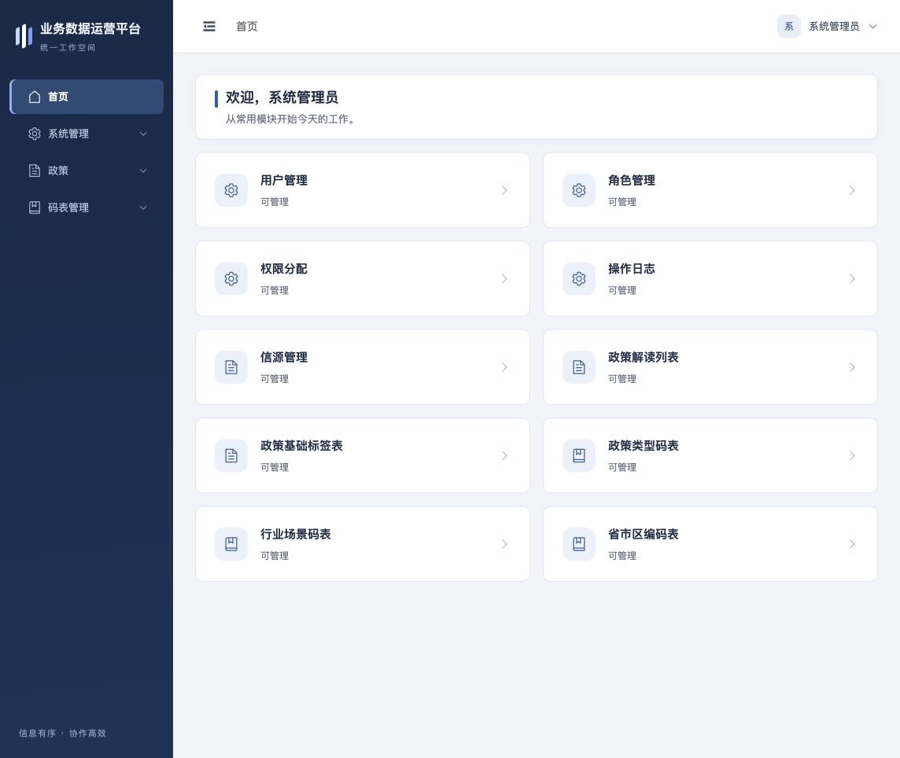
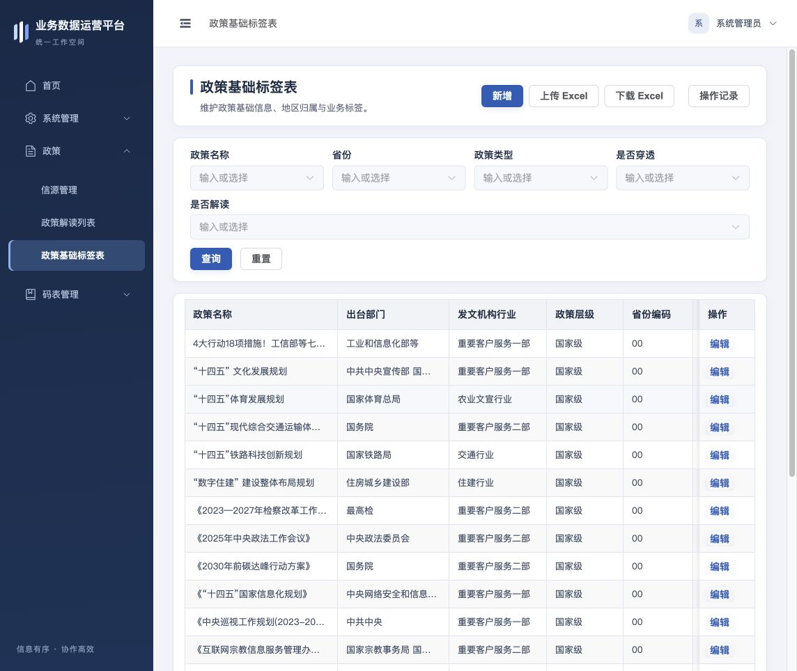
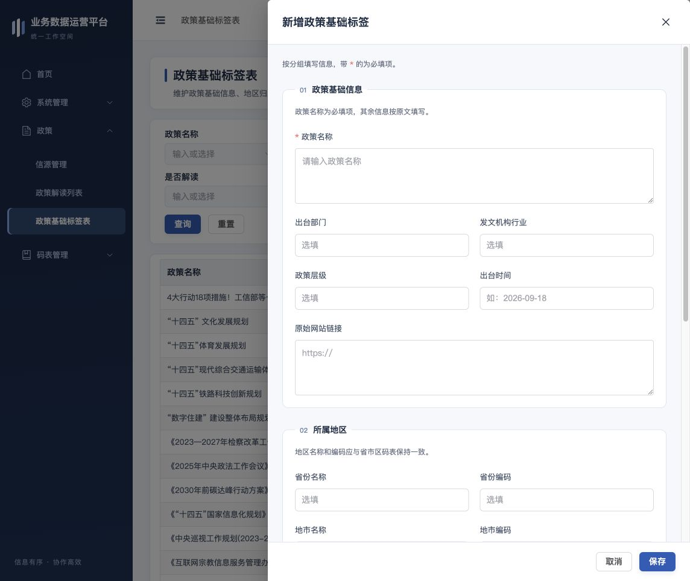
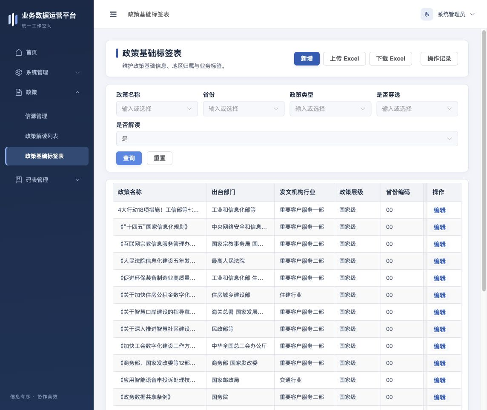
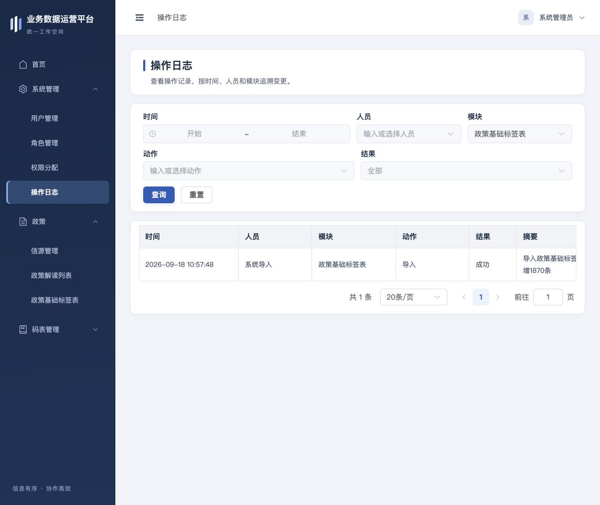
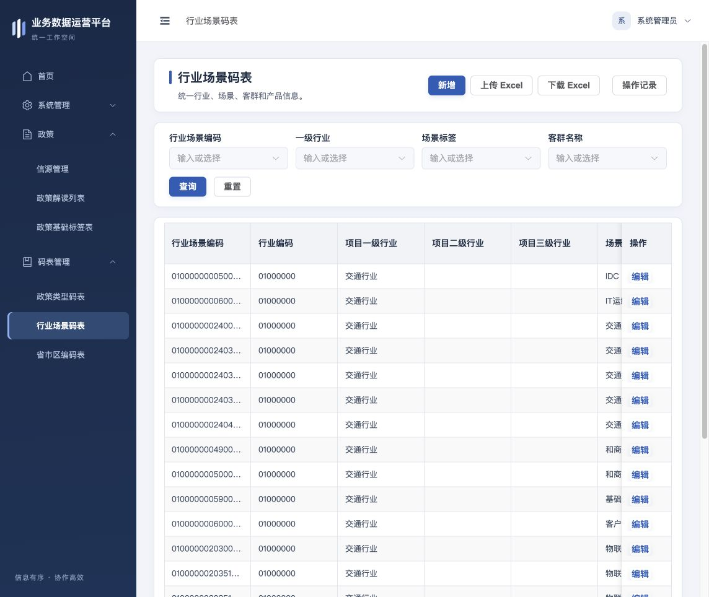

# UI / UX 第一阶段：审查与设计方向

> 历史方案归档，不能作为后续实现标准。当前规范见 [DESIGN.md](../../DESIGN.md)、[UX-CONTRACT.md](../../UX-CONTRACT.md) 和 [复用指南](../UI开发规范.md)。标题下混排部门/编码与仅齿轮列设置均已被用户否定；以后必须一列一字段，提供文字列设置和显示全部列。

日期：2026-09-20。状态：第一阶段历史记录；设计已确认并实施，后续调整以现行规范为准。

重构前基线：`d71902b`，提交标题 `chore: snapshot local state before UI UX redesign`。这是本地 Git 快照，包含原有代码、文档与业务参考 Excel/SQL；不包含数据库卷、环境密钥及本轮审查产物，未推送远程。

## 产品判断与证据

本产品是单组织内部业务数据运营平台。主要用户是维护政策、行业场景、标准码表的业务运营人员，以及管理账号、权限和追溯变更的管理员。日常工作是查询、核对、编辑、导入、导出和审计追溯。设计按政策、客户、招投标、码表、系统管理最终完整接入的规模规划，保持模块可扩展。

依据：README、架构文档、实现决策、开发进度、业务表主键与导入导出分析，以及当前 Vue 路由、共享组件和实际页面。架构文档和 README 部分旧段落仍称业务模块未开发，与当前运行状态不一致；本轮以最新进度及真实页面确认实现范围，不把旧占位说明当作现状。

- 当前可访问政策三个子模块、三类码表与系统管理。客户、招投标尚未实现；爬虫监测仅有规划。
- 未发布模块不得出现在普通导航中，发布后需明确授权；不能为展示未来扩展而伪造可用入口。
- NONE / READ / FULL 权限、最后管理员保护、只读审计、版本冲突机制保持原有约束。
- 六张业务表的导入匹配/去重规则尚未统一定稿，本轮不改变规则，也不把 Excel 上传描述为通用覆盖更新。
- “是否解读”属于现有业务字段，不等于“待解读 / 已完成”任务状态，不据此发明处理流程或仪表盘指标。

## 当前结构及可复用基础

前端：Vue 3、TypeScript、Vite、Element Plus、Pinia、Vue Router；中文 locale 已统一接入。后端：IAM、审计、政策、码表 FastAPI 服务，经本地 8080 网关访问；Vite 5173 对接实际开发服务。客户、招投标后端目录预留。

已有共享能力值得保留：`AdminLayout` / `AdminNavigation` 的收起侧栏和手机抽屉；`ListPage` 的标题、筛选、分页和错误重试；`ListEmpty` 区分空数据与无结果；`GroupedFields` 分组编辑；`useUnsavedForm` 未保存提醒；Excel 进度/结果组件；权限守卫与按钮权限。当前缺少根级 DESIGN.md、UX-CONTRACT.md。本阶段先记录待选方向，确认后再将批准的规范与运行时组件一起落地，避免把未批准视觉写成既定规范。

## 实际流程与截图

1. **首页进入模块：可用，入口优先级需调整。** 首页十个同等大小入口，系统管理占据最前位置；业务模块逐渐增多后会放大查找成本。建议按业务分组，以有真实使用记录的常用/最近访问入口辅助，不伪造待办数。
   
2. **政策基础标签列表：可用，信息层级需优先优化。** 实际 1,870 条，已有服务端分页；默认 20 个业务/审计字段加操作列，首屏优先出现地区编码，政策分类、解读标记在横向滚动后。长标题大面积省略，分页在长列表底部。
   
3. **新增表单与空提交校验：抽屉可用，纠错定位不足。** 已分三组并固定底部操作。空提交显示“请填写政策名称”，焦点仍在保存按钮，字段旁无持久错误提示。政策类型、是否解读等当前为自由文本；后续控件优化必须保留历史值，不擅自收紧业务枚举。仅测试空校验，未创建数据。
   
4. **筛选：查询有效，条件保持不足。** 选择“是否解读=是”后为 531 条，URL 未记录条件。筛选区在当前约 1144px 窗口下跨多行，单个布尔条件拉满一行。输入可创建筛选值，容易不清楚何时完成选择；应明确查询提交和清除行为。
   
5. **查看操作记录再返回：跳转正确，返回丢条件。** 日志页正确带入政策基础标签模块，显示现有导入记录；浏览器返回后“是否解读”恢复为空。日志页也有横向内容溢出，需要让摘要和详情入口易发现。
   
6. **390×844 手机访问：导航可用，数据效率低。** 页面整体无横向溢出（innerWidth=390，scrollWidth=390）。筛选及标题区到约 y=690，表格约 y=707 才开始，首屏仅少量记录。应收起高级筛选，保留搜索和筛选数量，将记录变成可展开的摘要列表。
   
7. **手机导航：基础良好。** 280px 抽屉、当前模块选中、关闭按钮均可见；已实际打开与关闭。后续仍需补键盘焦点循环、200% 缩放、虚拟键盘和触屏真机验证。
   
8. **无结果与恢复：可用。** 使用不匹配关键字后显示“没有匹配的结果”和“清除筛选”，清除后恢复数据。保留此区分，并在将来与首批空数据、失败、权限状态分别处理。
   
9. **同类行业场景列表：可用，同类问题会扩散。** 31 个业务字段加审计元数据；编码占据最前方且省略，描述和客群信息需横向查找。证明需要共享的字段优先级、详情和列设置能力，而非仅修政策页 CSS。
   

## 优先级与改进方案

本轮未确认阻断操作的 P0 问题；并不表示已经完成安全或全面功能验收。

| 优先级 | 问题与证据 | 方案 | 验收要点 |
| --- | --- | --- | --- |
| P1 | 返回列表丢失筛选，步骤4–5 | 统一列表状态 composable，保存已提交筛选、分页、页容量；普通业务列表默认 URL 同步，敏感筛选按实际场景例外处理 | 刷新、前进后退、日志返回恢复条件；新条件重置页码 |
| P1 | 宽表格无法快速核对，步骤2、9 | 默认列按任务选择；标题+部门组合；详情展示全部字段；保留全部列入口及现有导出 | 读者无需编辑即可读全长文本；字段不丢失；手机同样可访问 |
| P1 | 手机筛选挤占首屏，步骤6 | 搜索常驻，高级筛选抽屉/折叠；应用后显示条件数；手机摘要列表配合全屏详情/编辑 | 390px 首屏能看到主要记录，所有操作可达，页面无横向溢出 |
| P1 | 校验只靠 toast，步骤3 | 共享字段校验、字段错误关联、首错聚焦；保留输入；提交防重与稳定按钮宽度 | 错误一直保留至修正，键盘能定位，无重复请求 |
| P2 | 首页像平铺目录，系统入口优先，步骤1 | 按业务域组织工作台，系统管理降低视觉权重；导航按权限与发布状态生成 | 新模块接入无需重写壳层，不出现未授权/未发布入口 |
| P2 | 面包屑仅当前页，步骤2、5、9 | 业务域/模块/详情层级；清晰返回来源；保持路径和正式名称兼容 | 用户知道当前位置，跨模块返回路径明确 |
| P2 | 标题、筛选、表格多层卡片及密集边线，步骤2、9 | 裸页标题+一个主体工作区；保留轻分隔；调整字段层级和字号 | 信息对比清晰，减少空白但不压缩阅读 |
| P2 | 导入行为差异不易从入口看出，代码与业务文档 | 共用导入交互外壳，但展示每模块真实重复规则、进度、失败原因、结果统计 | 不改变 API 行为；不提供虚假的覆盖模式和撤销能力 |
| P2 | 状态高度和反馈规范缺少统一约定，静态证据 | 统一加载/无数据/无结果/错误/成功/只读/冲突矩阵 | 表格区域稳定，重试保留条件；保存成功刷新原列表 |
| P3 | 字体、圆角、色值和间距仍散落组件 | 根级 DESIGN.md + UX-CONTRACT.md，theme.css 为运行时 token 源，统一 Element Plus 适配 | 共享组件消除重复值，新模块按同一模板接入 |

## 核心样板与设计约束

选择“政策基础标签表”，因为它覆盖真实高频查询、长文本、多维筛选、分组编辑和批量导入，可推广到客户、招投标、信源、码表等数据维护页面。

三个独立概念图按本轮显示顺序存为 `concept-1.png`、`concept-2.png`、`concept-3.png`，供选方向，并非已实现页面。图片通过内置 ImageGen 生成，引用本轮真实列表截图；完整提示词见 `concept-prompts.json`。

**图片事实边界：** 概念图中的记录、日期、地区为示例排版；个别生成内容不等于现有数据或新增业务需求。图2生成的“文件编号/文件状态”等非当前字段不能进入实施范围；图3排序图标只有 API 支持并验证后才能启用，否则移除。不根据图中的示例链接发起访问。布局选择后，全部文案和字段回归现有接口契约。

第一阶段曾提出的共同规范（历史内容，不是现行标准）：

- 中文专业工作台，使用系统中文无衬线字体，标题24px/600，正文14px，辅助12px，编码和日期使用等宽数字；不引入装饰性英文大标题或营销插画。
- 延续现有 navy `#203955`、主色 `#2c68bb`、正文 `#20324c`、次文 `#697386`、背景 `#f3f6fa`、白色内容面。语义颜色由共享组件统一，不将布尔值伪装成任务完成状态。
- 间距 4/8/12/16/24/32px，控件6px圆角，桌面36–40px高，触屏操作目标至少44px；弹层才使用明显阴影。
- 一屏一个主要操作“新增政策”；导入次级，导出与操作记录仍可达。保留 READ/FULL 的真实权限行为。
- 默认表格展示政策名称/出台部门、地区、政策类型、出台时间、是否解读、操作。其他字段在详情或列设置中访问，Excel 功能保持。
- 桌面表头、分页和数据滚动区域明确归属；长表单独立自然滚动，不用全局 overflow:hidden 强行压缩。
- 手机搜索与结果优先，筛选集中展开，详情和编辑占满可用宽度，底部保存避开安全区和虚拟键盘。

## 确认后的推广顺序

1. 固化选择后的视觉、字体、颜色、密度与交互规范，建立 DESIGN.md、UX-CONTRACT.md 和共享能力归属表。
2. 打通政策基础标签完整样板：筛选 → 详情 → 编辑 → 成功/错误 → 返回；覆盖 loading、空数据、无结果、请求失败、冲突、只读及移动端。
3. 推广至信源、政策解读、政策类型、行业场景、省市区；表结构不同通过字段配置和有业务意义的变体解决。
4. 再推广工作台、用户、角色、权限、审计和个人设置。权限变更、禁用、清空等高风险动作单独核对，不仅套外观。
5. 后续客户、招投标、爬虫监测使用同一壳层和公共状态，业务流程待接口/规则明确后接入；不提前虚构子模块。
6. 每一批完成独立提交；按匹配窗口、数据与操作状态保留前后截图，可逐批回滚。

## 状态与验证计划

| 状态 | 目标行为 |
| --- | --- |
| 加载 | 应用自有 spinner，固定结果容器几何，标记 busy，阻止重复提交，处理过期请求 |
| 首批无数据 | 有权限时给新增/导入入口，只读用户提供明确解释 |
| 筛选无结果 | 显示已应用条件，提供清除筛选，保留可继续编辑的查询 |
| 请求失败 | 明确失败对象，重试保留筛选，不把旧数据当新成功结果 |
| 保存成功 | 关闭编辑、回原列表条件并刷新，统一成功反馈；toast 不是唯一数据证明 |
| 校验失败 | 字段旁说明和可操作建议，聚焦首错，保留输入 |
| 版本冲突 | 保留草稿，说明重载后果，不静默覆盖他人更新 |
| 导入 | 按模块显示真实规则，上传/处理进度、校验失败、部分处理或整批拒绝的实际结果 |
| 权限/未发布 | 遵循服务端授权与菜单发布；无权、未发布、服务失败不可混淆 |

已执行：

- 检查并复用运行中开发 Compose 服务，未启动 P6；启动 Vite，浏览器访问真实开发数据。
- 上述9步实际页面检查，含390×844、筛选531条、无结果/清除、空表单校验、日志返回及同类页面。
- `pnpm type-check`：通过。
- `pnpm lint`：通过。
- `pnpm test`：3个文件，10项通过。
- `pnpm build`：通过；现有主 JS 压缩后约1.14MB，Vite提示 chunk >500kB，后续评估按需加载。
- Premium静态严格扫描：退出1，报告1项“用户按钮未检测到动作”。经源码与浏览器点击复核，该按钮由父级 Element Plus Dropdown 处理，能展开个人设置/退出菜单，是静态扫描能力限制；原始输出保留于 `premium-baseline-audit.json`，不将扫描描述为通过。

证据限制：使用已有登录会话，未测试新登录/强制改密；未执行真实新增、编辑保存、导入、清空、授权或账号禁用；未人为中断后端，也未注入慢请求、离线、409等故障。加载、成功、失败和冲突的部分判断来自源码，完整行为验收留待选定方向后在隔离数据中进行。未进行完整屏幕阅读器、200%缩放、真机或WCAG合规认证。

本轮未修改业务源代码；现阶段交付的是实页审查、优先级、可扩展方案和视觉概念。正式前后实现对比与完整操作验收在第二阶段完成。
