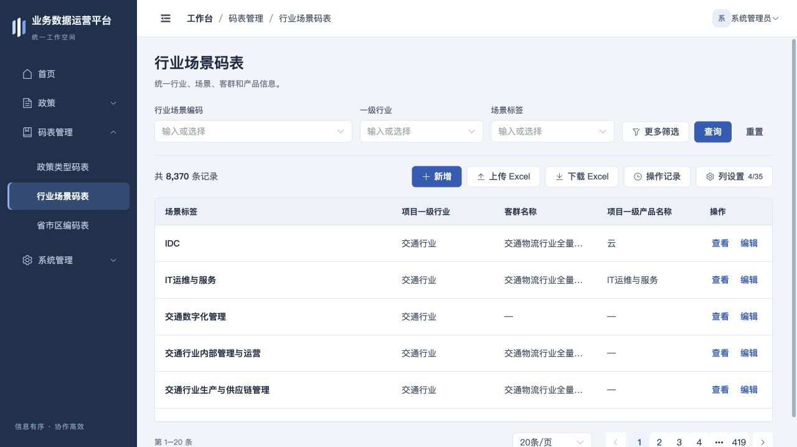
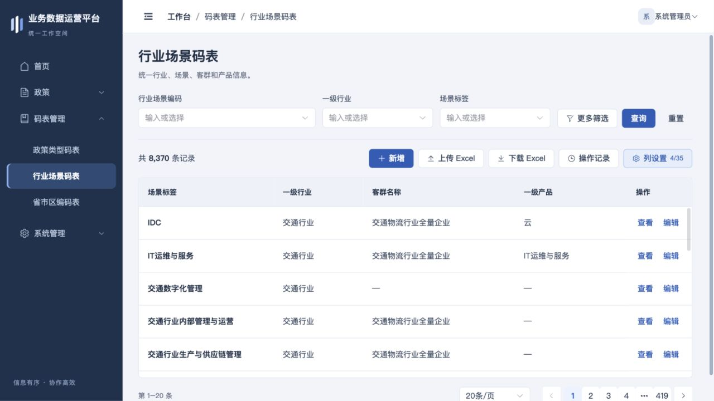

> 历史记录：本版默认核心列和限制表格总宽度的设计已被用户否定。现行规则为默认全字段、表格铺满内容区，见 [后续修订](../full-width/REVIEW.md)。以下保留当时检查记录，不代表当前视觉验收。

# 列宽与长表头复查

2026-09-20。实际访问 `http://localhost:8080`，使用现有业务数据；每个业务列表均先截图默认/全部列，再修改、重新构建 Docker frontend、复查。此前 UI 审查目录中的旧截图不代表本轮最终列宽。

## 发现与处理

| 优先级 | 证据与问题 | 处理结果 |
|---|---|---|
| P1 | 区县名称默认413px，场景标签380px；共享组件把主字段强制设为最小320px，空余宽度再次拉伸 | 去掉主字段特例；短字段固定宽，长标题/描述限幅伸缩 |
| P1 | 默认与全部列顺序不同；全选后编码/唯一标识挤到最前，常看字段跳位 | 两种模式共用顺序，核心默认字段在前，其他字段随后 |
| P2 | 信源默认列已溢出；时间170px时末尾被截断；日志详情列出屏 | 调整各页宽度，时间统一190px，固定右侧操作，局部滚动条常显 |
| P2 | “网站梳理和抓取的优先级”“目标客户当前政策影响客户群”等长表头难扫描 | 短名称与原业务名分离，表头/列设置用短名，悬停与详情保留原名 |

没有新增混合字段或辅助行；API、记录值、表单字段定义、Excel名称和导入导出范围未因本轮调整而改变。

## 六个业务列表：1280 × 720

数值为本轮浏览器实际测量，单位px；完整测量见 `metrics.json`（修改前）与 `after-metrics.json`（最终检查）。数据列数不包括操作列。

| 列表 | 默认/全部数量 | 默认视图的主要变化 | 默认/全部模式的稳定性 |
|---|---|---|---|
| 省市区编码 | 4/15 | 区县名413→160，省/市名160，编码112；表格左对齐，余量留在表外 | 短字段在两种模式下完全同宽；只显示省份也保持160 |
| 行业场景 | 4/35 | 场景380→242，客群165→272，减少不合理留白并给长客群更多空间 | 场景最低220、客群最低230；默认四列保持前置 |
| 政策类型 | 3/7 | 类型323→160，定义382→525，时间170→190 | 类型/时间同宽，定义全列时360，两行显示 |
| 信源 | 5/16 | 省100、地市110、抓取优先级120；网站310、标签235 | 短字段同宽；网站全列240、标签200；默认不再需要横滚 |
| 政策基础标签 | 5/20 | 政策324、省110、类型201、出台日期140、是否解读100 | 全列政策320、类型200；默认五列均可见 |
| 政策解读 | 4/26 | 政策370、机会110、目标客户275、补贴120；缩短客户表头 | 全列政策340、客户260，机会/补贴同宽；默认四列顺序不变 |

所有默认核心列在1280px测试视口下均可完整显示；全部列使用局部横滚而非挤压字段。长文本的内容仍可通过详情读取。

### 前后截图索引

| 列表 | 修改前默认 | 修改前全部 | 修改后默认 | 修改后全部 |
|---|---|---|---|---|
| 省市区编码 | [查看](before-areas-default.jpg) | [查看](before-areas-all.jpg) | [查看](after-areas-default.jpg) | [查看](after-areas-all.jpg) |
| 行业场景 | [查看](before-scenarios-default.jpg) | [查看](before-scenarios-all.jpg) | [查看](after-scenarios-default.jpg) | [查看](after-scenarios-all.jpg) |
| 政策类型 | [查看](before-types-default.jpg) | [查看](before-types-all.jpg) | [查看](after-types-default.jpg) | [查看](after-types-all.jpg) |
| 信源 | [查看](before-sources-default.jpg) | [查看](before-sources-all.jpg) | [查看](after-sources-default.jpg) | [查看](after-sources-all.jpg) |
| 基础标签 | [查看](before-base-default.jpg) | [查看](before-base-all.jpg) | [查看](after-base-default.jpg) | [查看](after-base-all.jpg) |
| 政策解读 | [查看](before-interpretations-default.jpg) | [查看](before-interpretations-all.jpg) | [查看](after-interpretations-default.jpg) | [查看](after-interpretations-all.jpg) |

以行业场景为例：

修改前：

修改后：

## 系统列表与交互检查

- 用户、角色、日志无默认/全部切换，按现有固定字段检查。用户/角色首列200px，表格上限920px；日志时间190px，摘要吸收余量，详情固定右侧。截图：[用户](after-system-users.jpg)、[角色](after-system-roles.jpg)、[日志](after-system-audit.jpg)。
- 六个业务列表逐一“恢复默认→显示全部→恢复默认”，数量正确，原有列不重排。检查结束已恢复原来的默认选择。
- 地区表取消到只剩省份：宽度160px，最后一列禁用取消；[截图](after-areas-province-only.jpg)。
- 全列拖动滚动条到末尾，入库/更新时间与右侧查看、编辑可见；[截图](after-interpretations-all-right.jpg)（长表头精简前拍摄，所验证的滚动/宽度实现未再改动）。
- 信源只读详情保留完整“网站梳理和抓取的优先级”和完整数据类型说明；场景“一级产品”表头的提示仍为“项目一级产品名称”。
- 解读页分别检查[1440px](after-interpretations-1440.jpg)、[1024px](after-interpretations-1024.jpg)；窄桌面保持可读最小宽度并局部滚动，无整页横溢出。
- 390px手机检查[默认](after-interpretations-mobile-default.jpg)、[全部](after-interpretations-mobile-all.jpg)、[详情](after-interpretations-mobile-detail.jpg)。短表头与桌面一致，默认和全部都维持摘要形式，完整字段在详情；documentWidth均为390。桌面截图测得documentWidth均等于视口宽度。
- 浏览器刷新后列选择保留；本轮末次控制台错误查询为空。临时视口覆盖已撤销。

## 工程验证与复用

- `pnpm test`：5个文件、19项通过。其中新增5项验证固定短字段、弹性分配上限、空间不足、余量再分配和顺序稳定。
- `pnpm lint`、`pnpm type-check`：通过。
- Docker单独重建frontend成功，内部执行`pnpm run build`通过，最新8080页面已实测。构建仍有原有主包超过500kB提示。
- Frontend Design Premium strict审查：0 findings；`git diff --check`通过。
- 已同步根目录DESIGN.md、UX-CONTRACT.md与docs/guides/UI开发规范.md：首列无宽度特权、固定短字段、限幅长字段、稳定顺序、简短表头与fullLabel。

本轮范围为列宽、字段顺序、表头与响应式回归，未重复真实写入或上传测试。既往记录中的Playwright CLI授权与官方designmd lint网络限制仍沿用原验证边界，不把本轮视觉检查等同全业务端到端验收。
