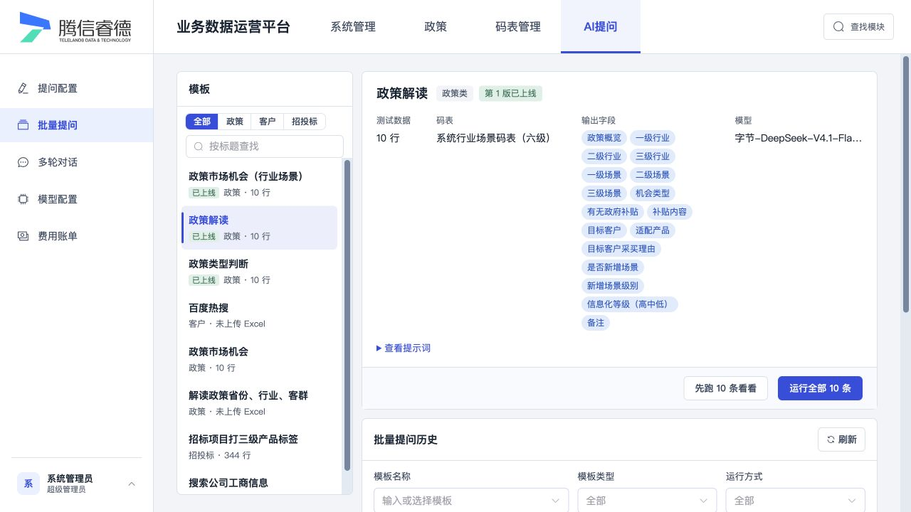
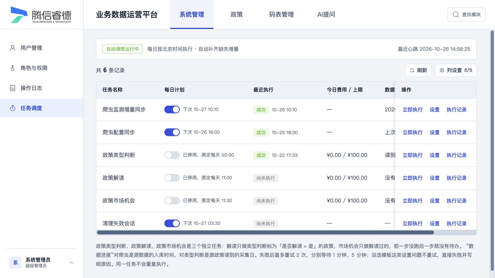
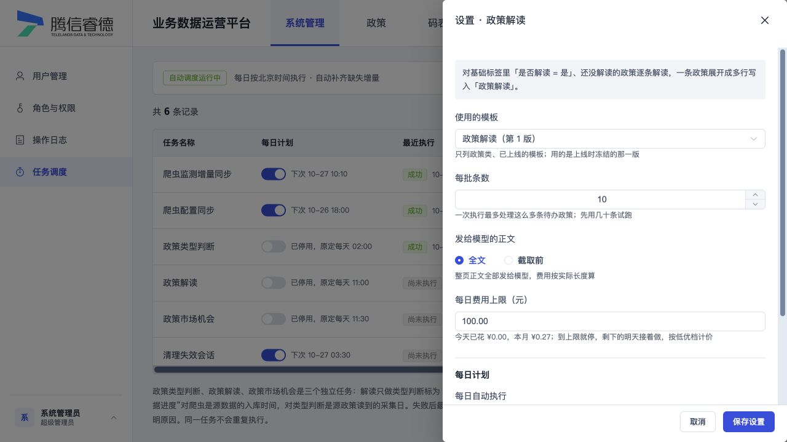
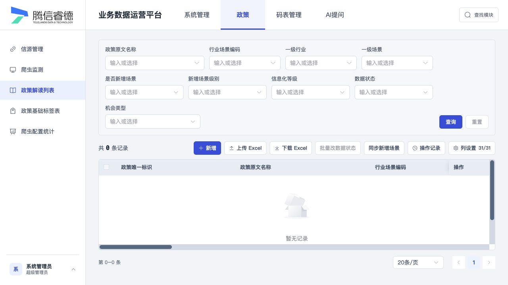
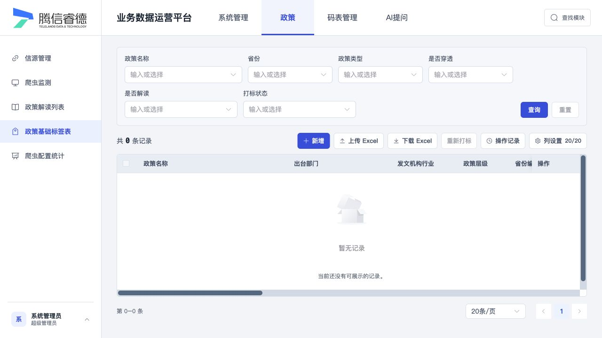

# AI 与政策处理流程设计审查

日期：2026-10-26。依据：实际部署环境管理员账号、1280×720 浏览器截图，以及当前前端源代码。只读查看，没有调用模型、执行任务或保存配置。

结论：提问配置与批量提问需要重组信息架构；多轮对话需要补齐会话交互；任务调度和政策表保留现有组件，优化布局与流程关联。保留现有品牌、Vue / Element Plus 与权限规则。

## 1. 提问配置：较差，优先重设计

优点：模板可搜索、按类型切换；上线状态和保存入口可见。
问题：在当前宽度试发区落在首屏以下；模板、编辑器和整页形成多个滚动区域。输出字段的十余个标签占据正文下面的大块空间，码表、数据和任务适配继续向下堆叠。保存、试发、上线分散，没有明确工作顺序。模型名称截断。
建议：模板导航可折叠；正文为主工作区；设置按组按需打开；测试在独立可切换工作区内展示样本、替换后请求、解析结果；发布集中呈现版本和任务检查。避免强制线性向导。
可访问性风险：次级标签字小且浅；多个滚动区域增加键盘定位成本。需后续测量对比度和键盘焦点。

## 2. 批量提问：较差，优先重设计

优点：运行前有数据量、模型和码表摘要，可小批测试。
问题：17 个输出字段挤成狭窄长列，将运行卡撑到大半屏；历史表首屏不可见。10 行数据同时显示“先跑10条”和“运行全部10条”，没有区分意义。模板测试数据直接作为批量数据，概念混淆。历史包含定时任务，但列表没有独立的来源维度，来源被写进发起人。
建议：任务列表为主页，新建任务按模板、输入数据、运行范围组织；输出字段用数量摘要和展开详情；样本数不超过总量，范围相同时合并按钮；明确手动批量与定时任务来源，提供结果详情而非主要依赖下载。
可访问性风险：字段标签文字偏小，模型名省略影响识别；完整值需同时支持键盘访问。

## 3. 多轮对话：空态清爽，交互能力待补齐

优点：阅读区域集中，输入区固定且清楚。这页的核心问题并不是杂乱。
问题：空态缺少与本产品相关的任务提示；模型名截断。代码显示换模型直接清空上下文，路由离开后会话没有持久化；回答使用纯文本 pre，缺少 Markdown、复制和失败重试入口。
建议：明确会话保留规则，换模型提示新开会话并保留已有记录；补会话历史、答案排版、复制和失败重试。业务快捷问题需对应真实能力，不暗示可读取未接入的数据。
限制：未发送付费提问，未实测流式回答、停止、费用和读屏播报。

## 4. 任务调度：基本可用，需优化

优点：每日开关、最近执行、费用上限、操作入口较直接；状态有文字。
问题：1280px 下数据进度被挤在固定操作列后，需要横向滚动；三个政策阶段和清理会话等运维任务平铺。流程依赖只在底部一大段说明中，用户难判断下一步。
建议：业务任务与系统维护分组；政策类型判断、解读、市场机会显示前后关系与待办、阻塞原因；增加查看输入、结果、模板的关联入口。服务在线和任务计划启用分别表达。

## 5. 任务设置：相对良好，局部优化

优点：模板、处理范围、预算、每日计划分组明确，说明上线冻结版本；底部保存取消固定。
问题：帮助文字密集，任务结果入口缺失。
建议：保留抽屉；增加当前模板详情入口，缩短常驻解释；预算与任务范围形成简洁执行摘要。
限制：只打开和关闭，没有修改或保存。

## 6. 政策解读列表：结构需优化，数据流程未验证

优点：筛选有明确查询动作，支持列设置、导入导出、批量状态和场景同步。
问题：9 项筛选占约240px；默认31列，首列是政策唯一标识，当前首屏主要呈现标识和编码，业务内容靠后。空态仅说明没有记录，没有说明数据从哪里来。
建议：增加审核与完整数据视图；审核视图前置政策名称、解读、场景、机会、验证状态；原文与解读并排核对。主要筛选常驻，其余按需展开。完整字段继续可访问和导出。
限制：当前返回0条记录，无法验证真实长文本、记录详情、人工验证及同步行为。

## 7. 政策基础标签表：基本框架可用，需强化处理状态

优点：筛选和表格结构一致，重打标有独立入口。
问题：默认20列，名称后优先展示部门、行业、层级与编码，处理状态没有成为显著的工作入口。空态没有导入或任务引导。代码显示重新打标后需用户另去任务调度执行。
建议：提供待判断、待解读、失败等快捷视图（数量须来自真实统计）；选择记录后就近呈现批量操作；重打标提交后提供对应任务入口和排队反馈。
限制：当前返回0条记录，无法实测重打标和结果回流。

## 实施顺序

1. 先确定模板、样本、批量输入数据、上线版本之间的产品关系。
2. 重设计提问配置与批量提问的布局和主要流程。
3. 补齐对话保存与阅读能力。
4. 串联政策数据、调度、结果审核入口。
5. 在1024、1280、1440、1920宽度验证；补键盘、焦点、对比度和长内容测试。

本次只验证1280×720下上述可访问状态，未完成全流程、全断点或可访问性合规验收。
