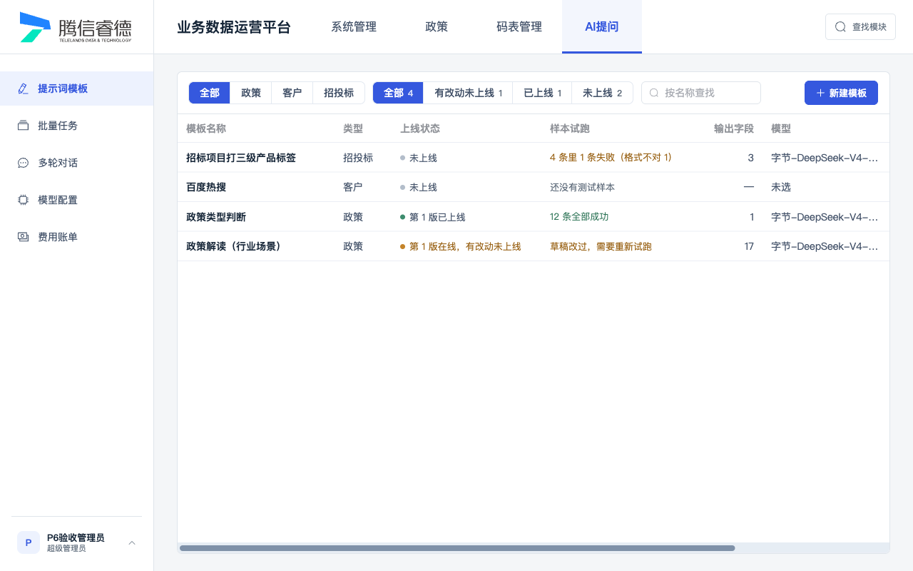
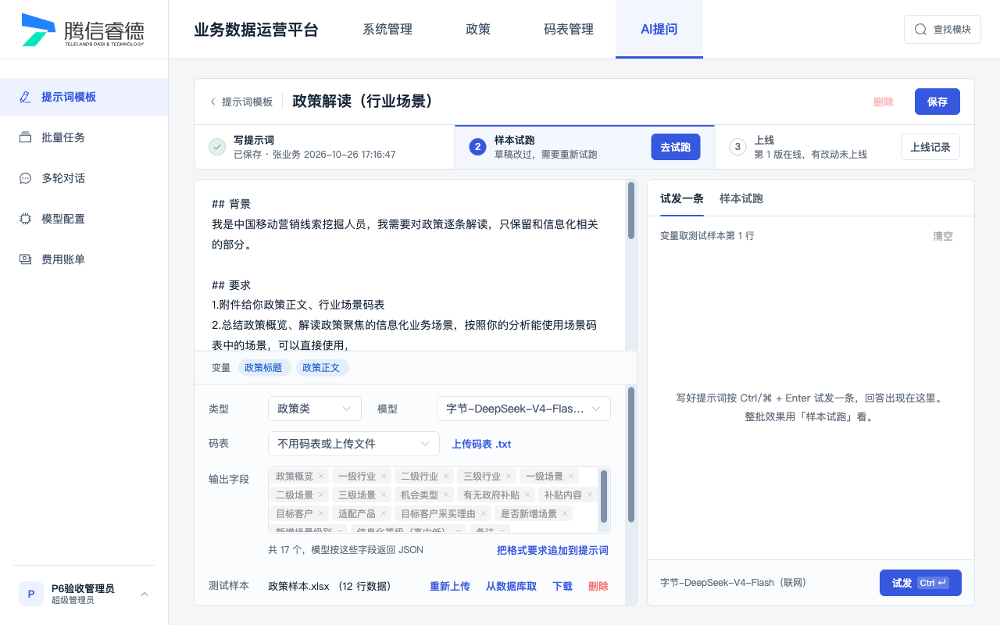
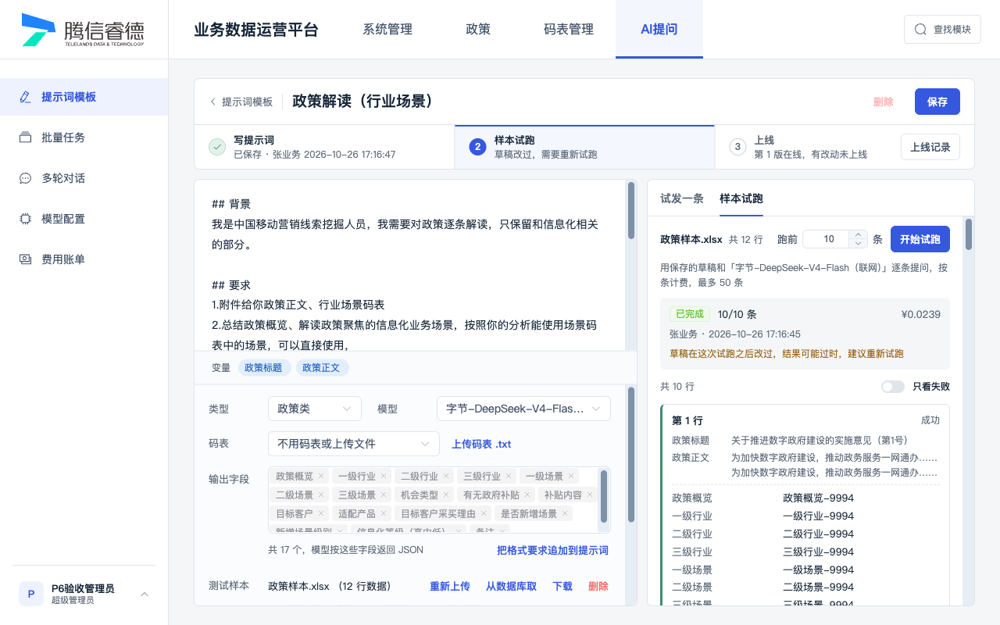
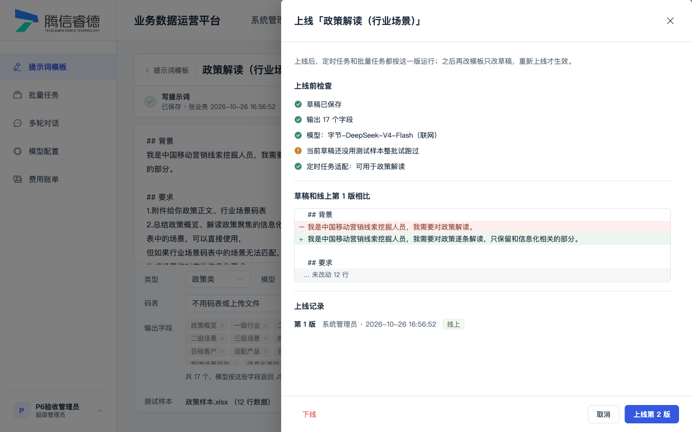
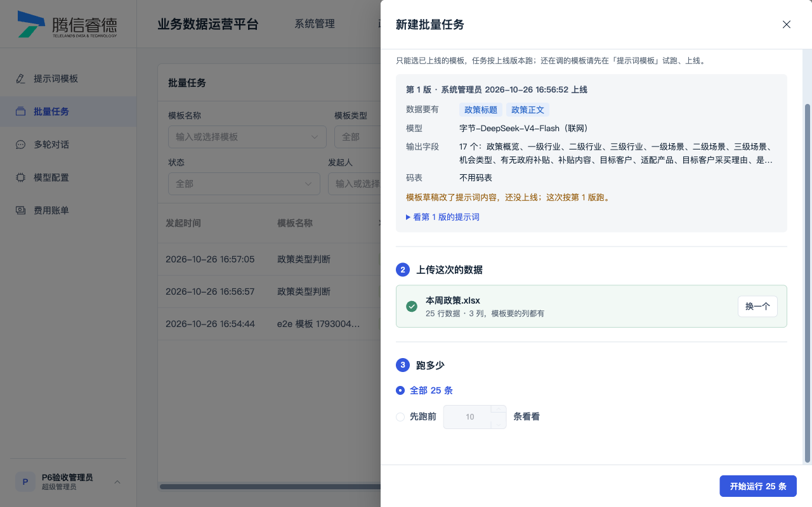
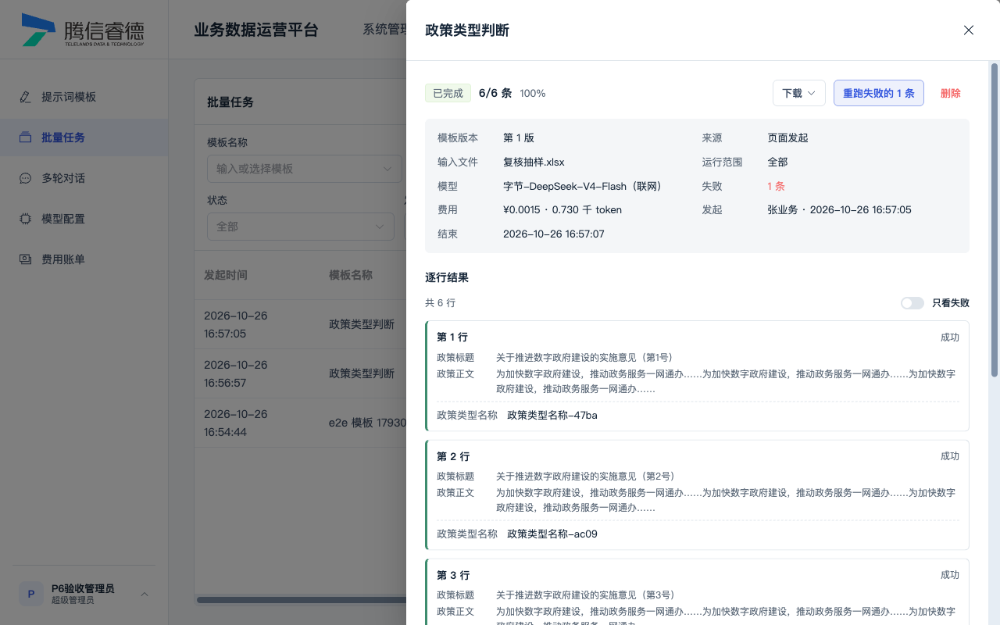

# 模板与批量任务分离

主线定为「业务人员写模板、用测试样本试跑没问题 → 管理员上线 → 定时任务和批量任务按上线版本跑」，页面按这条线重排。

- 菜单名为提示词模板、批量任务，路由和权限资源键不变。
- 提示词模板拆成列表页和编辑页。列表用「上线状态」「样本试跑」两列说清每个模板走到哪一步，管理员按「有改动未上线」找要审核的。
- 编辑页顶部是三步流程条（写提示词 → 样本试跑 → 上线），下一步那格高亮并给按钮；模板设置常驻编辑器下方，不再收起；右栏是「试发一条」「样本试跑」。
- 新增样本试跑：草稿 × 测试样本前 N 条（最多 50）整批跑，逐行看结果，不进批量任务列表，账单里单独一类。
- 上线改成抽屉审核：上线前检查、和线上版本的差异（提示词按行比较）、上线记录；业务人员可以只读打开。
- 批量任务只能选上线的模板，按上线版本跑；本次 Excel 单独上传，按上线版本引用的列检查，同一模板已有任务在跑、模型不可用都在发起前说清。任务记下第几版和输入文件名，可按来源（页面发起 / 定时任务）筛选，点行看详情和逐行结果。
- 输入文件、提示词、输出字段、模型、码表都冻结进任务；之后改模板、重新上线、删模板不影响任务和重跑。

## 检查

- `make check`、`make test-unit` 通过：前端 407 项单测（覆盖率在下限之上），AI 服务 132 项。
- P6 集成全过（验收脚本、调度 21 项、AI 8 项，含样本试跑和正式任务互不阻挡的真实库用例）。
- P6 的模型调用改发到模拟模型服务 `llm-mock`，e2e 不花钱跑通整条线：新建模板 → 试发 → 样本试跑 → 上线 → 新建批量任务（含一行模拟失败）→ 详情看失败原因 → 重跑失败 → 费用账单分出「批量任务」「样本试跑」→ 下线、删除。全量 e2e 57 过 1 败，失败的是爬虫配置统计（`crawler-config.spec.ts` 还在找已改成弹窗的「上周各省配置」标题，是上一个提交留下的，和本次改动无关）。
- 浏览器在 1024 / 1280 / 1440 / 1920 下看过列表、编辑页、上线抽屉、新建任务、任务详情，没有整页横向溢出；用只有模板和批量权限、没有上线权限的业务账号看过：流程条写「请管理员上线」，上线抽屉只读，只能查看的类型整块只读。

## 应用到开发部署机

尚未部署。要点：

- 有一条迁移（`c9e2a5b10909`：任务表加输入文件名、来源索引、表注释），部署时跑 ai-service 的 `alembic upgrade head`。
- `POST /api/v1/ai/batch-runs` 从 JSON 改成带文件的 multipart（参数在 query），前后端一起发布；重建 frontend、ai-service、ai-worker、iam-service、iam-worker，并同步 IAM 菜单让新名称生效。
- 行为变化要提前告诉业务人员：批量任务只能选已上线的模板。现在没上线、平时直接批量跑的客户类、招投标类模板，要先请管理员上线一次才能继续用。
- 生产 `.env` 不要配 `AI_LLM_BASE_URL`（只给 P6 用，生产配了会拒绝启动）。
