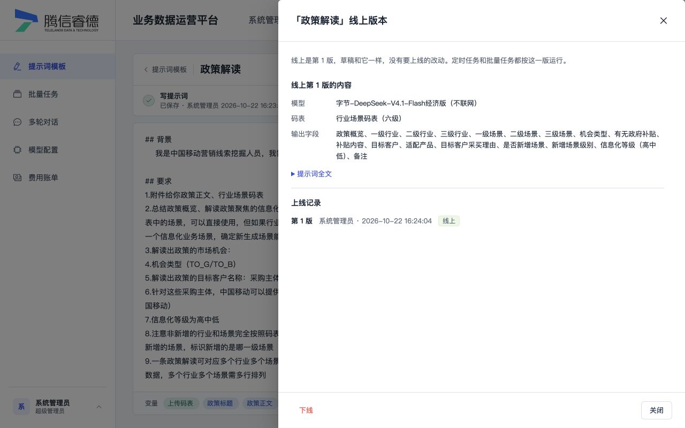
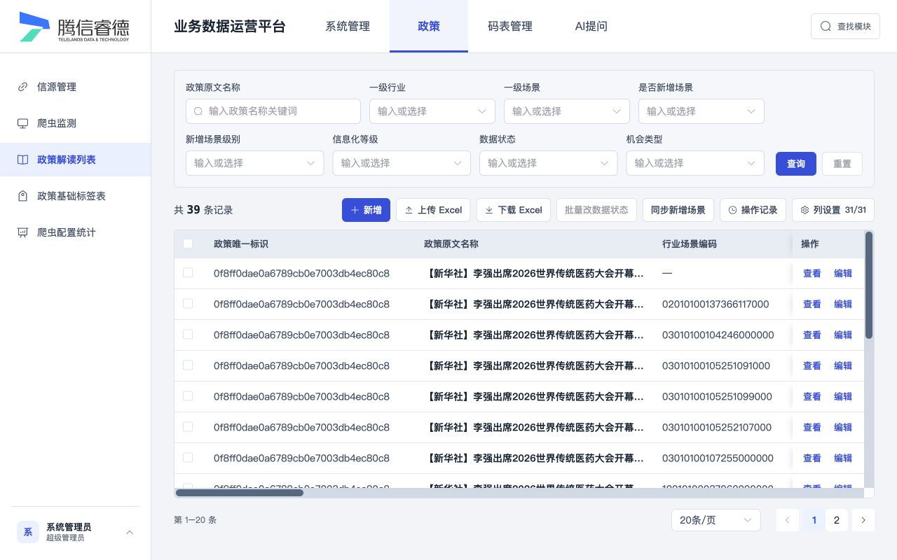
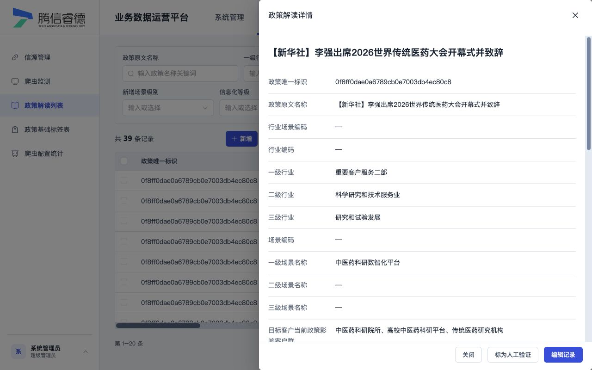
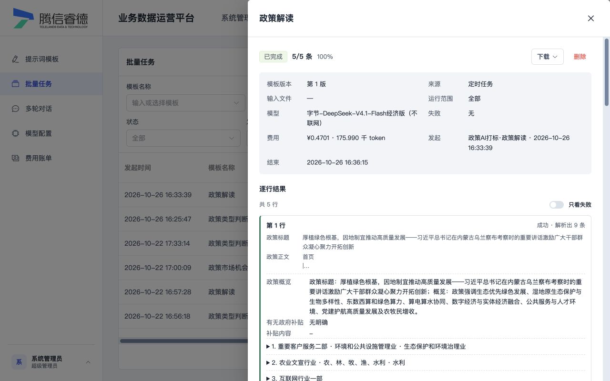
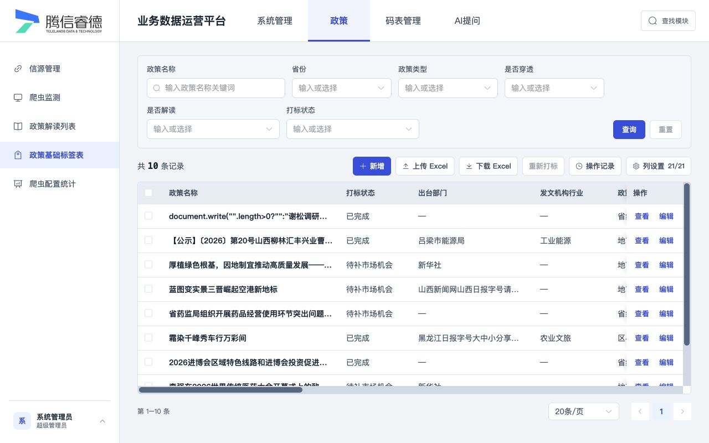

# 部署版二次复核

2026-10-27，刷新部署页面后检查，1280×800。只读导航和查看详情，没有保存、验证记录、发布、下线或调用模型。以下证据全部来自本轮。

## 1. 模板编辑：主要问题已改善

样本阶段显示“还没试跑”，不再把与线上配置一致当成测试成功。正文占据左侧大部分可见区域，不再被常驻配置挤成小块；并排测试仍保留。可继续观察用户是否容易找到下方设置，不建议再加回常驻大配置区。

## 2. 上线管理：已改善

入口改为上线管理；无改动时呈现线上版本信息，说明没有要上线的改动，没有红色错误，也没有无意义的下一版提交按钮。下线与关闭可见。未进行任何变更操作。

## 3. 政策解读列表：主要阅读问题仍在

默认31列，仍先展示唯一标识、政策名和编码；同一政策多条场景重复平铺。行业、场景、目标客户、机会、验证状态仍需横向找。建议增加显式业务核对视图或预设列组合，完整字段模式继续保留。

## 4. 政策详情：操作已补，阅读层级仍可改善

底部新增“标为人工验证”，阅读到动作的距离缩短。但正文仍按标识、编码、分类的字段顺序平铺，政策要文和机会靠下。建议业务内容分组优先、编码和审计信息次级展示。未点击人工验证。

## 5. 批量任务结果：已明显改善

显示每行“解析出N条”；公共字段只出现一次，变化字段按结果折叠。可读性较好。仍可优化：折叠摘要有多项只显示相同行业路径，难以判断对应哪个业务场景；优先显示场景名称，行业为补充。输入原文仍包含网页导航噪声，不应将老任务快照当成新版本处理错误；新任务的数据清洗效果本轮未验证。

## 6. 基础标签：状态已补，旧标题污染仍存在

打标状态已放到政策名称后一列，能直接看到已完成和待补市场机会。第一条标题仍是document.write(...)文本残留；需要有审计记录的历史数据修复或明确展示策略，不据此断言脚本执行。不可用刷新页面来验证旧数据库记录是否已被修复。

## 总体结论

主要状态语义与模板布局已经改善，接下来优先处理政策结果的业务核对视图，再完善详情分组与结果摘要。当前不建议推倒重做或继续大规模换视觉风格。

本轮未复测调度、对话、执行中及失败恢复；没有测量文字对比度或完整键盘顺序，不能据截图宣称无障碍合规。小字号、密集长表、多个重复折叠标题仍值得做键盘和读屏测试。
