# 部署新版 UI 与 UX 审查

2026-10-27。审查对象：https://1.119.196.77 。依据仅为本轮实时部署页面、截图及DOM；没有沿用旧截图或推定本地源码就是部署源码。主要视口1440×900，补充1280×800模板编辑页。已有登录状态，未输入账号密码。仅导航、切换页签、查看详情、查看设置，没有保存、上传、发布、下线、调用模型或执行任务。

## 总体判断

新版已经具备明确的模板列表、模板编辑/测试、发布版本、独立批量任务和逐行结果结构，不建议再整体推翻。主要剩余问题是状态含义不一致、编辑空间被配置压缩、结果逐项平铺，以及政策流程缺少业务视图和关联入口。建议在当前结构上做一轮有优先级的优化。

## 流程与证据

### 1. 用户管理：基本清楚

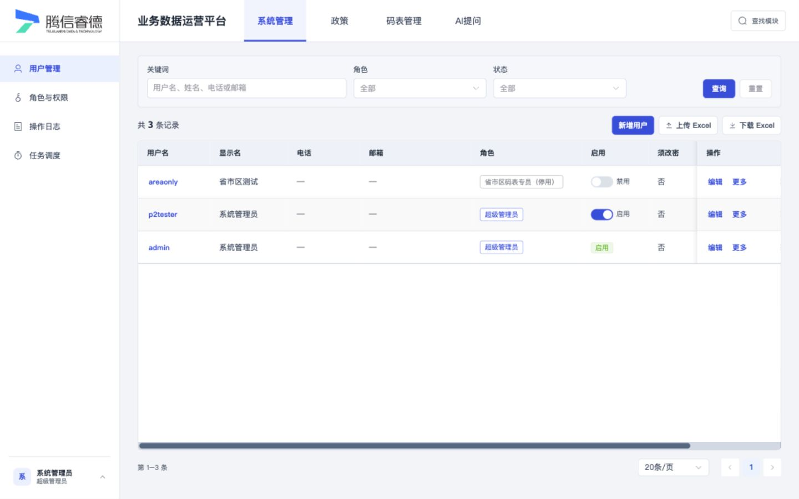

白色双层导航、筛选、操作栏和表格的关系一致；主操作新增用户明确。当前3条记录。表格仍较宽，时间字段不在当前首屏，但这不是本轮的主要问题。没有修改用户或权限。

### 2. 模板列表：结构合理，密度可优化

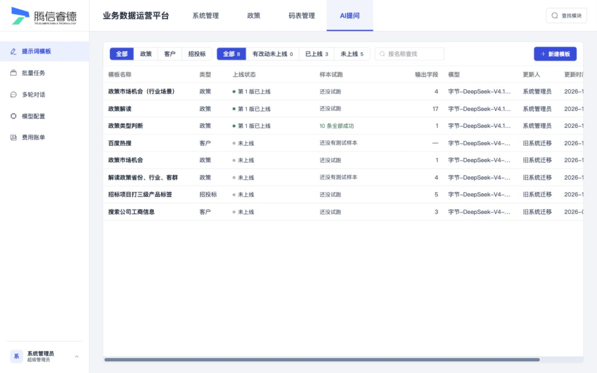

8个模板，按类型和上线状态过滤，显示样本试跑结果；点击模板名称进入独立编辑页。列表把维护工作与正文编辑分开，方向合理。两个并排分段筛选都从“全部”开始，建议增加类型/状态的轻量文字标签；模型名截断、更新时间需横向滚动，属于次级优化。

### 3. 模板编辑：主次分配仍有问题

编辑和试发同屏，比把测试藏在下方更易操作。但左侧提示词、设置区各自滚动，输出字段内部还有滚动，阅读路径仍碎片化。17个字段、测试文件、模型、码表、任务适配同时常驻，长提示词在1440首屏也只能读到部分内容。

建议：正文作为编辑主区域；低频配置摘要化、可展开，设置提供独立完整编辑空间；试发保留并排。优先减少嵌套滚动，不靠继续缩小字号。

### 4. 样本试跑：状态表达有误导风险，优先修复

模板列表对“政策解读”显示“还没试跑”；编辑页进度条的“样本试跑”却是绿色勾选，说明为“和线上第1版一致”。切换样本试跑页没有本次试跑结果。上线面板又明确提示“当前草稿还没用测试样本整批试跑过”。

这不等于后端试跑数据有错误，但界面将配置一致性当成测试阶段的完成状态，会让用户误判。

建议：分别显示保存状态、测试状态、发布状态。测试状态只能由真实运行结果决定，未测试用中性样式；“草稿与线上一致”归入发布状态。测试成功建议明确“解析成功N/N”，不要暗示内容正确性已由人工核对。

### 5. 发布/版本记录：功能齐，但入口和语义不一致

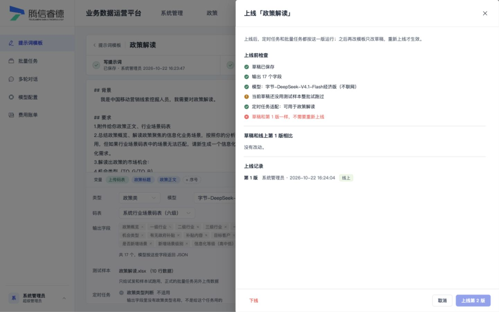

点击“上线记录”打开的是标题“上线「政策解读」”的面板，里面同时有检查、差异、历史、下线和上线按钮。用户以为查看记录，却进入包含变更操作的界面。

无改动被显示为红色叉号“草稿和第1版一样，不需要重新上线”，这实际是正常状态，不宜像故障一样报红。

建议：入口改为“发布与版本”，或让“上线记录”只查看历史；无差异使用中性提示“当前已是最新版本”。保留版本冻结说明和上线前检查。

### 6. 批量任务列表：清楚，保留主体

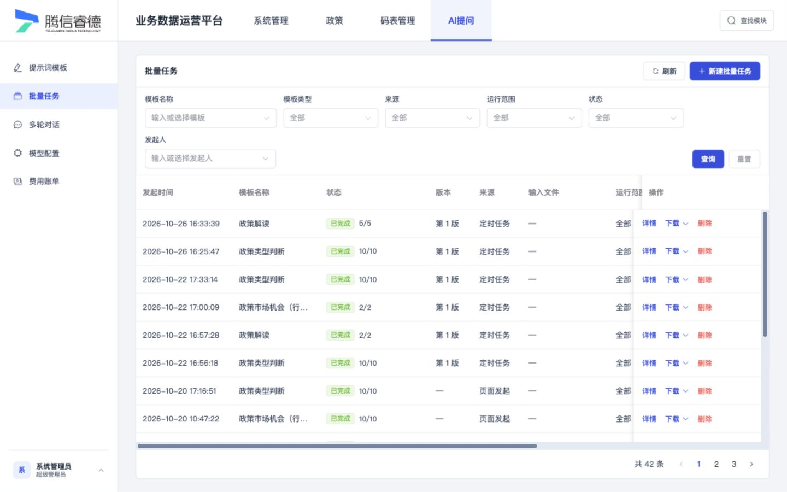

当前42条历史，状态、版本、来源明确，详情和下载直接可达。页面不再常驻模板栏和大运行卡。宽表仍需要横向阅读，模型、费用等可在详情集中查看；是否增加列设置可按真实使用频率判断。

### 7. 新建批量任务：本轮较好的流程

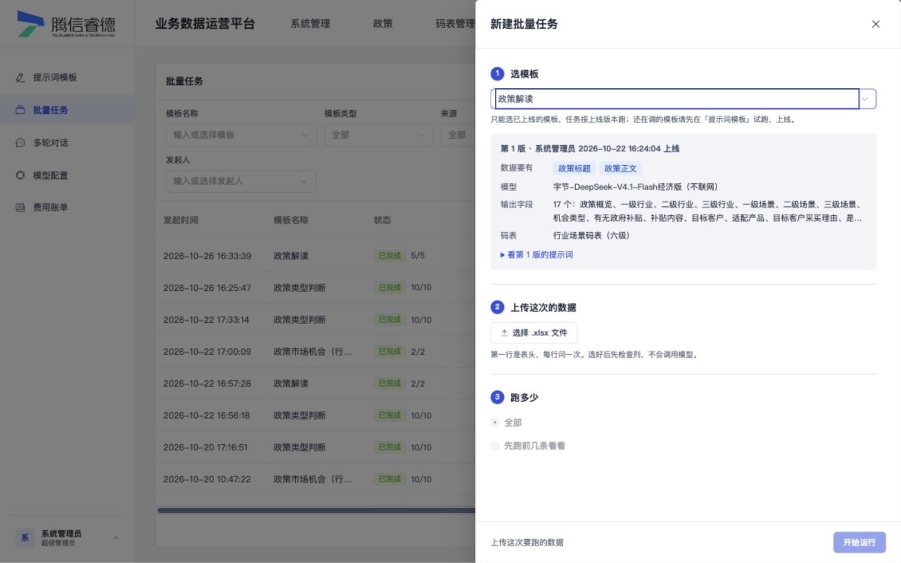

“选模板→上传这次的数据→跑多少”顺序清楚。只能选已上线模板，选项解释未上线原因；明确版本、所需输入列、模型、码表；上传前说明预检不调用模型。模板样本与正式输入分离。

建议保留。输出17字段的长清单可默认收成数量摘要，但优先级低于编辑页和政策结果页。未上传或创建实际任务，本轮未验证上传失败、费用确认和执行中反馈。

### 8. 任务详情与逐行结果：能查结果，但核对成本高

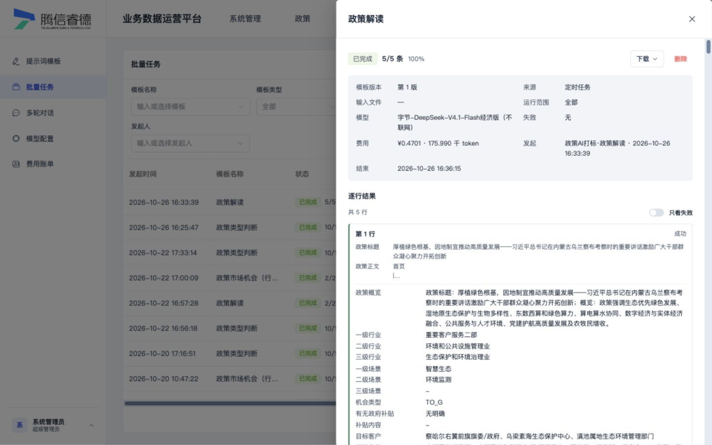

已有版本、来源、费用与进度概览，新增逐行解析结果很好。问题是5条输入中的第一条就展开多个行业场景，每个场景重复展示17个输出字段和政策概览；页面上需要滚动大量内容才能到第二条输入。输入正文预览还能看到“首页、简、繁、登录”等抓取页噪声，不利于核对。

建议：左侧输入行目录（标题、状态、输出条数），右侧当前行的原文和结果；场景结果逐个折叠；默认突出失败、缺失字段、需核对项；元信息与长原文按需展开。标明“输入5条、输出39条”这类不同口径时须来自实际统计，本轮只确认任务输入5条和政策解读表共39条，不推断39条均来自该任务。

### 9. 多轮对话：空态清楚，会话连续性仍需验证

页面简单、输入区明确，不属于视觉杂乱。帮助文案仍写“换模型或点新对话就从头开始”，未见会话列表。没有发送消息，因此不能据此确认刷新/离页的保留行为，也不能评价新版回答排版、复制、重试和流式可读性。

建议：明确当前是临时对话还是保存会话；有内容时换模型/新对话应保护已有内容。不要为填满空白而堆功能卡片。

### 10. 任务调度：运维可用，业务链路不够直观

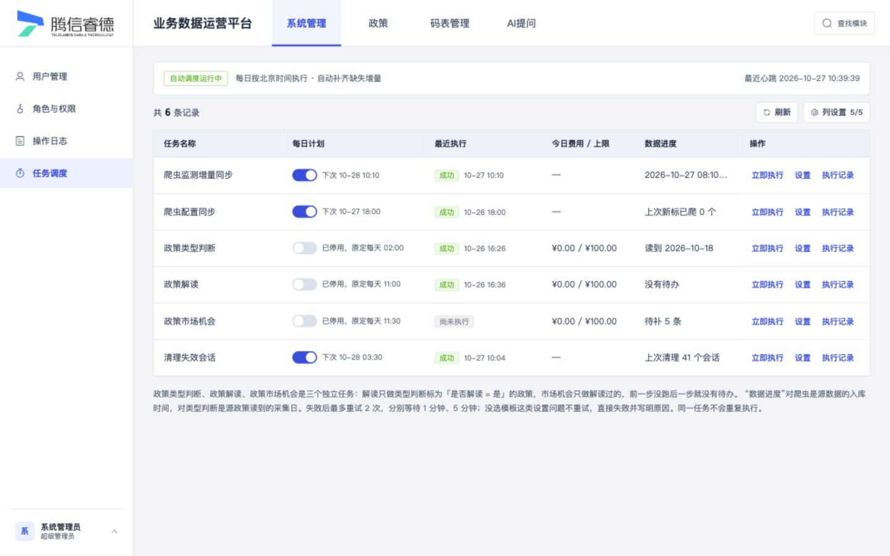

6条任务，三个政策阶段与爬虫同步、会话清理平铺。市场机会显示“待补5条”，但没有直接查看这5条数据/解读结果的入口；依赖关系仍写在底部长段说明里。顶端“自动调度运行中”表示服务运行，三个政策任务实际均停用，建议通过文案区分引擎在线与业务计划启用。

建议：分业务任务与系统维护；三个政策阶段显示顺序、待办、阻塞原因，提供“查看待处理政策/解读结果”入口。保留设置和执行记录。

### 11. 调度设置：分组清楚，已有有效提醒

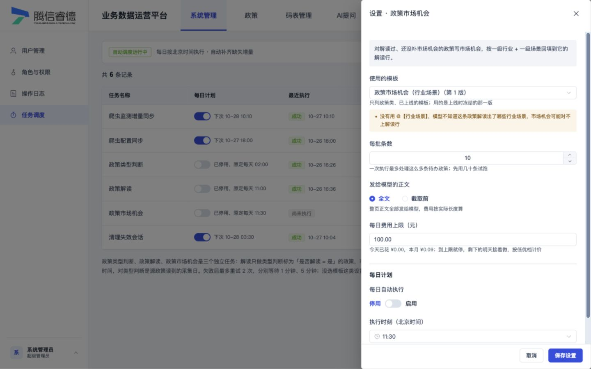

模板、每批数量、正文、预算、每日计划分组明确。市场机会模板下有“不使用@【行业场景】可能导致结果对不上”的提醒，属于有价值的业务反馈；这也是当前配置值得核对的一项，但没有据此推断结果已经错误。未保存任何设置。

### 12. 政策解读列表：最需要优先改善的业务阅读页面

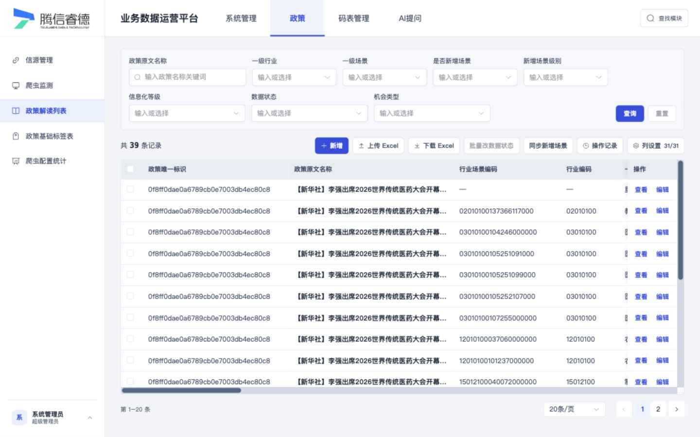

39条记录，默认31个数据字段。政策唯一标识在第一列占较大宽度，随后是政策名称、行业场景编码、行业编码；同行重复政策标题却无法快速看到场景、机会、数据状态。结果区可以横向滚动，但滚动能力不等于业务阅读顺畅。

建议：保留完整字段视图与Excel能力，增加“业务核对视图”；主字段优先呈现政策名称、行业/场景名称、目标客户、机会、验证状态，编码仍可访问。按政策分组展开多个场景。当前默认全字段是既有规则，如要变更默认必须明确协调；增加显式可切换视图能减少对原有完整数据工作的影响。

### 13. 政策解读详情：完整，仍按字段平铺

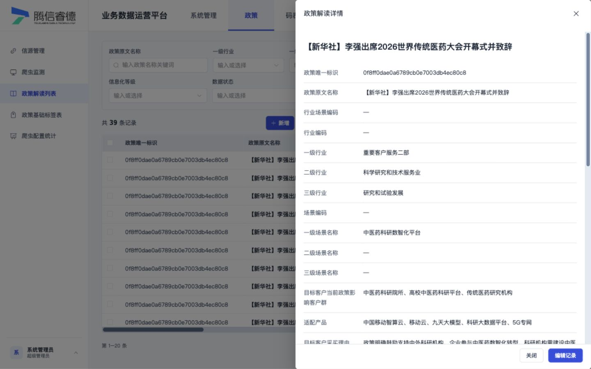

抽屉第一屏又先展示唯一标识、多个编码和三级分类，政策要文、市场机会、数据状态在更下方。只有关闭和编辑记录，没有就近的验证动作，无法在阅读结果时直接完成核对流程。

建议：原文/政策概览、场景与机会、验证操作优先；编码与审计信息单独分组收起。避免所有字段等权重展示。

### 14. 基础标签表：处理状态不突出，存在标题污染

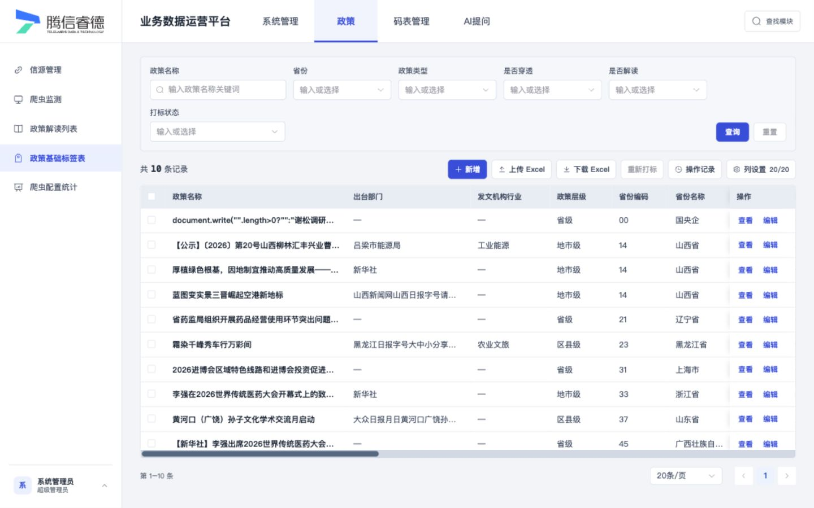

当前10条记录，默认20字段。筛选有打标状态，但默认表头没有独立打标状态列；需要处理什么、当前处于哪一步不直观。第一条政策名称直接显示document.write(...)残留。这是输入内容清洗/显示的问题，不据此断言脚本被执行或存在XSS。

建议：增加可见的处理阶段/状态与任务关联；针对失败、待处理、已完成提供快捷视图。标题去除页面脚本/模板残留，保留原始数据供追溯；不要只在UI上静默改掉业务原文。

### 15. 1280宽模板编辑：嵌套滚动更明显

正文可见高度约200px，设置区约占左侧下半区，17个输出字段标签容器自身也出现滚动；加上设置滚动，用户需要在不同区域之间切换。左右保留并排测试是优点，但应该减少配置区常驻占用，而不是压缩正文。

## 优先顺序

1. 修复测试阶段的完成状态与“无差异报红”的语义；统一发布入口名称。
2. 调整模板正文与低频配置的空间分配，减少嵌套滚动。
3. 增加政策结果的业务核对视图与按输入行/政策组织的结果浏览。
4. 打通调度待办与政策结果入口，突出基础标签的处理状态；排查标题污染。
5. 再做字重、次级文字对比度、按钮尺寸和宽表密度的细节调整。

## 可访问性与证据限制

- 观察到页签有可访问名称和选中状态、表单多数有标签、状态有文字；这些是基础优点，不等于全面通过无障碍检查。
- 多滚动容器、小尺寸标签删除按钮、淡色说明和长模型名称截断属于风险；需后续测量对比度、验证Tab顺序、焦点返回和屏幕阅读器流式播报。
- 没有执行付费操作、发布、下线、保存、导入导出或改变用户权限。对话有内容后的行为、执行中、错误恢复、批量失败重跑均未实测。
- 不做手机端可用性结论；初始窄浏览器不作为桌面产品缺陷证据。报告主要截图为1440桌面，另有1280模板编辑证据。

## 核对与处理

逐条对照截图、部署代码和线上数据（只读）核对，事实部分全部属实，数字（8 个模板、42 条任务 = 页面发起 36 + 定时任务 6、6 个调度任务、解读 39 条 31 列、基础标签 10 条 20 列、17 个输出字段）都对得上。按下面处理：

- 样本试跑状态（§4）：流程条改成只按真实试跑结果写，和列表、上线检查同一说法；已上线且草稿没改时照实写「还没试跑」，灰色、不当下一步催。成功写「N 条全部解析成功」。
- 上线面板（§5）：没有改动时不再报红，也不出现检查清单和「上线第 N 版」按钮（报告漏了这一处：没改动时灰掉的主按钮仍写「上线第 2 版」），只看线上版本内容和上线记录、可下线；入口改名「上线管理」。
- 编辑页嵌套滚动（§3、§15）：左栏只留一条滚动条，提示词跟着内容长高、至少占六成高度，变量行贴底；设置区仍常驻不收起（已定规则），但不再自己滚，输出字段全部展开。
- 模板列表（§2）：两组切换加「类型」「上线状态」小标签；调列宽，1440 下不再横向溢出。
- 任务详情（§8）：一条输入解析出多条时，各条一样的字段只列一次，每条折叠成一行摘要；没做左右分栏。正文开头的「首页、简、繁、登录」不只是显示问题，它就是发给模型的正文：正文提取改为去掉导航、页头页脚，400 条源政策实测正文少约四分之一，没有丢正文句子，打标费用跟着降。
- 多轮对话（§9）：换模型、点「新对话」在有内容时先确认。不加会话列表——对话上下文存在模型服务端、本系统不存对话，页面已写明。
- 任务调度（§10）：状态条改写「执行进程在线」，旁边写启用、停用各几个任务；「待解读 N 条」这类待办可点进基础标签并按打标状态筛好。阶段分组、依赖说明没动。
- 政策解读（§12、§13）：详情抽屉加「标为人工验证」。「业务核对视图」、详情字段重排没做：列表默认全字段、按 Excel 列序是已确认的产品规则。
- 基础标签（§14）：加只读的「打标状态」列，和筛选同一套条件。`document.write(...)` 标题查明是爬虫源库原样存的，打标时取出其中文字作政策名称、备注注明，源库不改；已入库的那一条在重新判断类型时会被改正。
