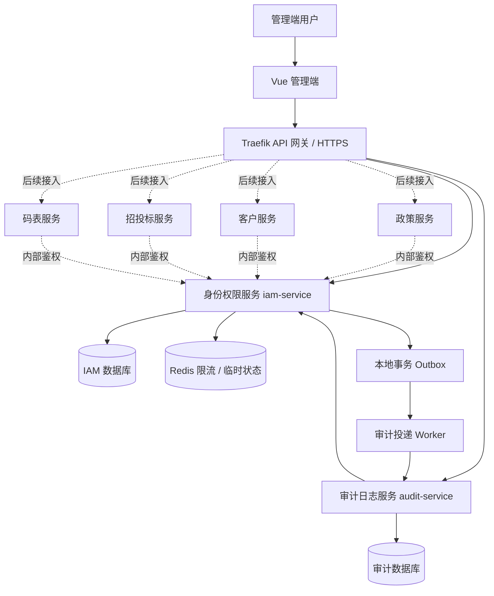

# 业务数据运营平台公共基础框架设计

> 现状说明（2026-09-24）：本文是 V1.1 设计基线，公共框架已按它实现完。以下几处已被后续实现取代，以代码和 CLAUDE.md 为准：
>
> - 第 6.2 节的授权档位：导出已从 FULL 中拆出，现为 NONE / READ / EXPORT / FULL 逐档包含，导出动作必须标 EXPORT。
> - 第 6.1 节的资源树：系统管理菜单已合并为「用户管理 / 角色与权限 / 操作日志」；政策下新增爬虫监测 v2，码表下新增省市区编码。
> - 给人分配角色的所有入口都要求 `system.permissions:grant`，而它只能授予超级管理员角色（见 CLAUDE.md「系统管理」）。

版本：V1.1 ｜ 日期：2026-09-16 ｜ 状态：设计基线，待按阶段实现

## 1. 建设目标与本期范围

建设一个 Vue 前端、Python 后端的业务数据运营平台，采用微服务架构。先完成公共基础能力，再逐步接入政策、客户、招投标、码表管理等业务。各业务大模块支持子模块，通过角色决定用户能否访问，以及只能查看还是可以操作。

本文件是架构与实施设计，不代表公共服务已经编码或验收完成。当前工作区已为四个业务服务及其前端模块创建空目录；业务表、业务接口暂不实现。

### 1.1 本期必须完成

- 登录、退出、修改密码、管理员创建账号、重置密码、禁用账号；不提供注册页面或注册接口。
- 用户管理、角色管理、用户分配角色、角色分配模块权限。
- 模块及子模块权限树、菜单过滤、页面守卫、按钮控制、后端接口鉴权。
- 登录日志、操作日志、权限配置变更记录。
- 网关、统一接口规范、数据库迁移、配置管理、容器部署、健康检查、基本监控。
- 业务服务模板与接入约定；四个业务目录保持空目录，不启动占位服务。

### 1.2 首期边界与默认假设

- 按单组织内部管理系统设计。暂不加入多租户、部门数据隔离、审批流、第三方登录、短信及邮件通知。
- “模块只读”表示可以查看该模块的数据，不代表只能查看本人或本部门数据。后者属于未来的数据范围权限，需业务规则明确后另行设计。
- 单一 Vue 管理端，不使用微前端；后端服务可独立构建、部署和迁移。
- 初期采用单仓库和 Docker Compose；生产高可用部署在规模与可用性目标确定后实施。
- 码表管理按用户提出的业务大模块保留，不提前假定它是其他服务共享的字典中心。

## 2. 系统架构



### 2.1 拆分原则

1. 按业务边界拆服务，不按表拆服务。用户、角色、权限和会话先放在同一个 IAM 服务，便于保证授权事务一致性。
2. 每个服务拥有自己的数据库和数据库账号；其他服务不得直接查询其表，不建立跨服务外键。
3. 初期允许共用一个 PostgreSQL 实例，但必须使用独立数据库及凭据。后续可迁移到独立实例。
4. 同步调用使用内部 HTTP API；审计记录通过本地事务 Outbox 异步投递。
5. 共享代码只包含协议、鉴权客户端、日志和通用工具，不共享业务 ORM 模型。
6. 网关负责边界流量控制，服务自身负责最终授权，不能只依赖前端或网关。

## 3. 技术框架

以下是首期建议基线，具体补丁版本在编码时通过兼容性验证并锁定；不使用浮动 `latest` 镜像。

| 层级 | 选型 | 用途 |
| --- | --- | --- |
| 前端 | Vue 3 + TypeScript + Vite | 管理端应用与构建 |
| 路由与状态 | Vue Router + Pinia | 页面守卫、用户状态和菜单 |
| UI | Element Plus | 表格、表单、权限树、弹窗 |
| HTTP | Axios | 超时、错误处理、单次刷新重试 |
| 前端包管理 | pnpm + lockfile | 固定依赖、可复现构建 |
| 后端运行时 | Python 3.12 | 初始兼容性基线 |
| Web 框架 | FastAPI + Uvicorn | HTTP API、参数校验、OpenAPI |
| 数据校验 | Pydantic 2 + pydantic-settings | DTO、配置校验 |
| ORM / 迁移 | SQLAlchemy 2 + asyncpg + Alembic | PostgreSQL 异步访问及迁移 |
| 数据库 | PostgreSQL 17 | 用户、角色、权限、审计等持久化 |
| 临时存储 | Redis | 登录限流、短期状态；不作为权限唯一数据源 |
| 网关 | Traefik 3 | TLS、服务路由、超时、访问日志 |
| 密码与令牌 | Argon2id + 非对称签名 JWT | 密码哈希、短期访问令牌 |
| 内部 HTTP | HTTPX | 超时、连接池和服务调用 |
| 后端依赖 | uv + uv.lock | 服务依赖固定和环境管理 |
| 质量检查 | Ruff、mypy、pytest | 静态检查与后端验证 |
| 前端验证 | vue-tsc、Vitest、Playwright | 类型检查、权限逻辑、关键流程 |
| 运维 | Docker Compose、结构化日志 | 本地集成与初期部署 |
| 可观测性 | OpenTelemetry 接入点 + Prometheus 指标 | 请求追踪和服务指标；看板按需接入 |

不在首期引入 Kubernetes、服务网格、独立配置中心、独立注册中心、Kafka 或分布式事务框架。Compose 网络通过服务名发现服务，配置通过环境变量与挂载密钥注入。

## 4. 公共服务设计

### 4.1 身份权限服务：iam-service

职责：账号、认证、会话、密码、角色、角色分配、模块权限、菜单元数据、权限判定。

内部分层：`api → application → domain / repositories → database`。API 层处理请求与响应，应用层编排事务，权限规则集中在领域层，避免在每个接口复制判断逻辑。

包含以下功能：

| 功能 | 规则 |
| --- | --- |
| 创建用户 | 仅授权管理员操作，设置初始密码，首次登录强制修改 |
| 编辑用户 | 管理用户名以外的基本资料；用户名首期创建后不修改 |
| 禁用用户 | 禁止新登录，并撤销已有会话 |
| 重置密码 | 管理员生成一次性临时密码，仅当次显示，不写入日志 |
| 分配角色 | 一个用户可有多个角色；角色须处于启用状态 |
| 管理角色 | 创建、编辑、启停；关联用户的角色归档前必须确认替代方案 |
| 分配权限 | 权限树上设置无权限、只读或全部功能 |
| 会话管理 | 本人退出、退出全部设备、管理员强制下线 |
| 自助功能 | 查询本人资料、修改本人密码；不能自行分配角色 |

### 4.2 审计日志服务：audit-service

职责：内部接收审计事件、去重入库、授权查询、日志归档与到期清理。

- 面向管理端只提供查询接口；不提供修改、单条删除日志的接口。
- 写入入口仅对已认证的内部服务开放；浏览器不能直接提交可信审计事件。
- 登录日志和操作日志使用同一事件模型，以事件类型区分。
- 首期不开放日志批量导出；以后作为独立动作授权。
- 审计表写入账号与清理任务账号分离。日常应用不能更新历史记录。
- 审计数据库不是防篡改存证系统；如果后续有存证要求，再接入不可变对象存储及校验链。

### 4.3 公共代码包：platform-common

这是代码库，不是独立服务。提供：

- 统一异常、错误码、分页响应、请求 ID 与日志脱敏。
- JWT 验证与 IAM 权限检查客户端。
- `require_permission(resource, action)` 后端依赖。
- 审计事件模型、Outbox 基础组件、健康检查。

各服务固定公共包版本。禁止通过公共包导入 IAM 数据库模型或业务表。

### 4.4 基础设施与未来公共能力

PostgreSQL、Redis、网关是基础设施。文件上传、通知、定时任务平台等不是本期服务，等具体业务需要出现后再建设，避免提前增加维护成本。

## 5. 业务服务预留

| 大模块 | 服务目录 | 稳定资源编码 | 未来 API 前缀 |
| --- | --- | --- | --- |
| 政策 | `services/policy-service/` | `policy` | `/api/v1/policy` |
| 客户 | `services/customer-service/` | `customer` | `/api/v1/customer` |
| 招投标 | `services/tender-service/` | `tender` | `/api/v1/tender` |
| 码表管理 | `services/codebook-service/` | `codebook` | `/api/v1/codebook` |

当前仅创建四个业务服务及其前端模块的空目录。下列业务目录已由用户明确，作为后续菜单、权限资源和代码目录的设计依据；本次只更新文档，不创建业务表、接口或页面。

### 5.1 已知模块目录与权限资源

| 大模块 | 子模块 / 页面 | 建议资源编码 | 建议前端相对目录 |
| --- | --- | --- | --- |
| 政策 | 信源配置 | `policy.sources` | `policy/sources/` |
| 政策 | 爬虫监测 | `policy.crawler_monitoring` | `policy/crawler-monitoring/` |
| 政策 | 政策解读列表 | `policy.interpretations` | `policy/interpretations/` |
| 政策 | 政策基础标签表 | `policy.base_tags` | `policy/base-tags/` |
| 码表管理 | 政策类型码表 | `codebook.policy_types` | `codebook/policy-types/` |
| 码表管理 | 场景码表 | `codebook.scenarios` | `codebook/scenarios/` |
| 客户 | 暂无子模块，保留客户目录 | `customer` | `customer/` |
| 招投标 | 暂无子模块，保留招投标目录 | `tender` | `tender/` |

目录名称按已确认需求记录，英文编码为本方案建议。子模块属于对应业务服务的内部模块，不各自拆成微服务。“政策基础标签表”“政策类型码表”等是当前菜单名称，不表示已经确定数据库表结构。

### 5.2 预留与发布规则

- 政策、码表管理作为分组目录；其下每个子模块分别配置 NONE / READ / FULL。
- 客户、招投标暂按单一权限资源预留，以后明确子模块时再细分。
- 公共框架初始化时可登记上述资源，但全部标记为未发布；普通导航不展示，权限配置树可显示“未开发”，禁止对未发布资源新增授权。
- 子模块的查询、新增、编辑、删除、执行任务等实际动作，待业务说明后逐一确定，不能仅凭菜单名推断。
- 业务实现并发布后由管理员显式分配权限，不因预留目录或发布而自动授权。
- 政策基础标签与两类码表的关系、爬虫的执行方式和外部依赖均待业务阶段明确。

未来每个业务服务：独立数据库、独立迁移、独立镜像；接入统一鉴权和审计；仅通过 API 获取其他服务的数据。

## 6. 权限模型：模块只读 / 全部功能

### 6.1 权限对象

采用 RBAC：`用户 → 多个角色 → 模块/子模块授权 → API 操作`。

资源树（包含已知业务目录，业务资源暂未发布）：

```text
系统管理 system
├── 用户管理 system.users
├── 角色管理 system.roles
├── 权限分配 system.permissions
└── 审计查询 system.audit
政策 policy（分组）
├── 信源配置 policy.sources
├── 爬虫监测 policy.crawler_monitoring
├── 政策解读列表 policy.interpretations
└── 政策基础标签表 policy.base_tags
客户 customer（暂不设子模块）
招投标 tender（暂不设子模块）
码表管理 codebook（分组）
├── 政策类型码表 codebook.policy_types
└── 场景码表 codebook.scenarios
```

已知子模块按第 5.1 节预留资源编码；后续新增子模块不需要修改通用权限算法。政策和码表父目录不作为独立业务操作资源，客户、招投标暂保留一级资源。

### 6.2 三档授权与操作分类

| 配置 | 能力 |
| --- | --- |
| NONE：无权限 | 不显示菜单，后端拒绝全部该资源操作 |
| READ：只读 | 列表、详情、普通搜索等已登记只读操作 |
| FULL：全部功能 | 包含 READ，加上该资源已登记的新增、修改、删除、导入及领域操作 |

- 权限按资源和动作判断，不按 HTTP 方法猜测。POST 搜索也可能是只读，GET 接口不得修改业务状态。
- 批量导出可能造成数据批量外流，默认归入 FULL；以后可增加独立导出权限。
- “全部功能”限定在被授权的资源内，不代表能管理所有用户、分配角色或修改整个系统权限。
- 未登记的资源、未登记的动作、未声明鉴权的业务接口，默认拒绝。

动作注册示意：`resource=policy.interpretations, action=list, required_level=READ`；若业务确认支持新增，则 `action=create` 对应 FULL。此处仅说明鉴权格式，不代表已确认该页面的具体功能；实际动作在业务开发时登记。

### 6.3 父子模块、覆盖与多角色规则

为避免隐含继承导致未来子模块自动放权，首期采用“显式资源授权”：

1. 权限树父节点选择 READ 或 FULL，是批量设置当前已发布子模块的 UI 操作。
2. 保存时写入每个可授权资源的明确等级；父节点自身只有存在实际接口时才单独授权。
3. 新增子模块默认 NONE，即使父模块以前选过 FULL，也需要重新分配。
4. 子模块允许单独调整，父节点显示全选或半选状态。
5. 同一用户多个启用角色取最高等级：`NONE < READ < FULL`。
6. NONE 表示该角色没有授予权限，不是显式拒绝；不会抵消其他角色授予的权限。
7. 禁用用户、禁用角色、撤销会话属于访问前置条件，不能被其他角色绕过。
8. 父级目录是否显示取决于是否存在可见子页面，菜单不单独赋予后端权限。

示例：

| 用户角色 | 客户模块授权 | 合并后 |
| --- | --- | --- |
| 客服只读 + 无客户授权角色 | READ + NONE | READ |
| 客服只读 + 客户管理员 | READ + FULL | FULL |
| 政策管理员 | 客户 NONE、政策 FULL | 只能操作政策 |

### 6.4 系统管理权限及防止提权

系统用户管理、角色管理、权限分配是不同资源：

- `system.users:FULL`：创建、编辑、禁用、重置普通用户；不能单凭此权限授予角色。
- `system.roles:FULL`：维护普通角色资料和状态；不能单凭此权限修改角色授权。
- `system.permissions:FULL`：授予角色、修改角色授权。
- `system.audit:READ`：查询审计日志。

权限分配是高权限能力。首期只由系统超级管理员持有其 FULL 权限，普通授权管理员的委派和授权上限暂不实现。普通业务角色的 FULL 不包含这些权限。

超级管理员是受保护的内置系统角色，拥有当前及后续资源的管理权限；其配置不能被普通管理员修改。新增超级管理员需要现有超级管理员操作并留审计。

禁止禁用、删除或撤销最后一个可登录超级管理员，检查在事务内加锁处理并发操作。首次登录必须改密、账号禁用、会话撤销等安全条件对超级管理员同样有效。

### 6.5 前后端执行

前端：登录后获取 `/auth/me` 与 `/auth/permissions`；按权限生成可见菜单；路由通过 `meta.resource` 判断访问；按钮使用统一 `v-permission` 指令或组件。权限配置页面可以显示完整资源树，普通导航只显示已发布且有权访问的页面。

后端：业务接口声明资源与动作；先验证令牌，再向 IAM 检查会话、账号和当前授权。直接调用 API、修改前端状态或伪造按钮不能绕过检查。

首期内部权限判定不缓存允许结果，每个受保护请求读取 IAM 的权威状态，优先保证权限撤销及时性。未来有性能证据后再设计版本化缓存及明确的失效窗口。

权限变更提交后，后续鉴权立即使用新结果；已通过检查并正在执行的请求不会自动回滚。需要更强撤权保证的敏感业务操作，应在提交前再次确认授权。

## 7. 登录、令牌与会话

### 7.1 登录流程

1. 用户提交用户名和密码，按账号与来源 IP 双维度限流。
2. IAM 校验账号状态及 Argon2id 密码哈希，失败返回统一错误，记录脱敏登录事件。
3. 登录成功创建会话，返回短期 Access Token，并设置 Refresh Token Cookie。
4. 首次登录或管理员重置密码后，仅允许修改密码及退出；完成后重新签发普通会话。
5. 前端加载个人资料、权限及菜单，进入第一个有权访问的页面。没有业务权限时显示无可用模块提示。

### 7.2 建议初始参数

- Access Token 有效期 15 分钟，保存在前端内存中，不写入 localStorage。
- Refresh Token 为不可预测随机值；数据库仅存哈希；会话绝对有效期 7 天。
- Cookie 设置 `HttpOnly`、`Secure`、`SameSite=Strict`，Path 限于认证接口所在路径；本地 HTTP 开发使用单独配置。
- 刷新令牌每次使用后轮换；旧令牌再次出现时撤销整条会话族。
- 前端刷新采用 single-flight，并协调多标签页刷新，防止并发刷新误触发重放检测。
- Cookie 参与认证的刷新、退出等接口验证 Origin 与 CSRF Token；生产前后端同源部署。
- JWT 包含 `sub`、`sid`、`iss`、`aud`、`iat`、`exp`、`jti`，不包含完整权限树。
- 固定允许的签名算法，校验 issuer、audience、有效期；通过内部 JWKS 获取公钥，使用 `kid` 支持密钥轮换。
- 建议登录连续失败 5 次后进入可配置的短时限制，并返回明确的重试等待时间。

这些时长和阈值是产品初始配置，不是不可更改的业务规则。

### 7.3 撤销和降级规则

退出撤销当前会话；改密、重置密码、禁用账号撤销该用户全部会话。角色及授权修改直接影响后续 IAM 判定，不等 Access Token 到期。

IAM 不可用时，业务服务对受保护请求返回 503，不放行。Redis 不可用时已登录请求仍可从数据库校验；依赖 Redis 的登录限流失败时登录接口返回 503，不能静默关闭限流。数据库不可用时不允许认证及权限变更。

## 8. 网关设计

### 8.1 路由

| 外部路径 | 上游 | 说明 |
| --- | --- | --- |
| `/` 和静态资源 | frontend 容器 | Vue 页面；API 不适用 SPA fallback |
| `/api/v1/auth/*` | iam-service | 登录、刷新、个人资料和密码 |
| `/api/v1/system/*` | iam-service | 用户、角色、资源、权限 |
| `/api/v1/audit/*` | audit-service | 审计查询 |
| `/api/v1/policy/*` | 后续 policy-service | 首期不配置，上游不存在时不伪装成功 |
| `/api/v1/customer/*` | 后续 customer-service | 同上 |
| `/api/v1/tender/*` | 后续 tender-service | 同上 |
| `/api/v1/codebook/*` | 后续 codebook-service | 同上 |

保留完整 API 路径，上游按同一路径定义接口，避免多处改写。`/internal/*`、内部健康详情、指标和生产 OpenAPI 不对公网发布。

### 8.2 网关职责和信任边界

- HTTPS 终止、路径路由、请求体大小限制、连接及响应超时、入口限流、请求 ID、访问日志。
- 首期业务授权全部在服务内执行，不使用 ForwardAuth 增加第二次重复的授权调用。
- 删除客户端伪造的 `X-User-Id`、`X-Roles` 等身份头；服务不以这些头作为身份凭据。
- 仅信任指定上游代理的转发头；审计客户端 IP 不能直接采用任意 `X-Forwarded-For`。
- 生产只开放网关 443；服务、PostgreSQL、Redis 不映射公网端口。
- 内部 IAM 检查和审计写入使用每服务独立凭据，限定调用范围；凭据不下发浏览器。跨主机通信启用 TLS，后续按部署条件升级 mTLS。
- 业务服务调用 IAM 时传递原访问令牌，IAM 自己验证用户身份，不能信任调用方直接声明的 user_id。
- 默认 API 超时 30 秒、内部权限检查 2 秒；超时返回可区分的 504 或 503。具体参数在压测后调整。
- 不自动重试 POST/PATCH/DELETE；未来需要可重试写操作时加入幂等键。

## 9. 公共数据库设计

以下只涉及公共能力，不创建业务表。ID 默认 UUID，时间统一 UTC `timestamptz`，接口输出 ISO 8601，前端按显示时区格式化。

### 9.1 IAM 数据库

| 表 | 主要字段 | 约束及说明 |
| --- | --- | --- |
| `iam_users` | id, username, display_name, password_hash, status, must_change_password, password_changed_at, version, created_at, updated_at | username 归一化后唯一；status 为 active/disabled/archived |
| `iam_roles` | id, code, name, status, is_builtin, version, created_at, updated_at | code 唯一；内置角色受保护 |
| `iam_user_roles` | user_id, role_id, granted_by, created_at | 联合唯一；仅本库外键 |
| `iam_resources` | id, code, parent_id, name, service_code, node_type, published, sort_order | code 唯一；校验树无环；node_type 区分目录和资源 |
| `iam_resource_actions` | id, resource_id, action_code, required_level | resource_id + action_code 唯一；级别为 READ/FULL |
| `iam_role_grants` | role_id, resource_id, level, updated_by, updated_at | role_id + resource_id 唯一；仅存 READ/FULL，NONE 对应无记录 |
| `iam_menu_items` | id, parent_id, title, route_name, resource_id, icon, sort_order, enabled | route_name 来自受控前端路由清单，不能注入任意组件 |
| `iam_sessions` | id, user_id, family_id, created_at, expires_at, revoked_at, last_seen_at, client_info | 用户和失效时间索引；客户端信息脱敏 |
| `iam_refresh_tokens` | id, session_id, token_hash, issued_at, expires_at, consumed_at, replaced_by | token_hash 唯一；保留已用令牌用于重放检测 |
| `iam_outbox` | event_id, event_type, schema_version, payload, status, attempts, next_retry_at, lease_until, created_at | event_id 唯一；投递和重试索引；按租约回收异常任务 |

外键删除策略默认 RESTRICT；用户和已使用角色采用禁用或归档，避免破坏审计关联。密码与令牌字段不出现在任何用户列表响应中。

用户编辑和角色权限编辑使用 `version` 做乐观并发控制；版本冲突返回 409。用户名唯一冲突在数据库层处理，避免只靠前端检查。

资源、动作和基础菜单通过随代码发布的清单同步。界面管理权限分配，不能凭空创建没有实现接口的权限。清单同步应幂等；移除资源先停用，再检查授权引用。

### 9.2 审计数据库

`audit_events` 主要字段：

| 字段 | 用途 |
| --- | --- |
| id / event_id | 存储主键 / 来源事件唯一标识，用于重试去重 |
| occurred_at / received_at | 事件发生时间 / 接收时间 |
| source_service / schema_version | 来源服务 / 协议版本 |
| trace_id / request_id | 请求关联 |
| actor_id / actor_name_snapshot | 操作人标识 / 当时名称快照 |
| module_code / action_code | 所属模块 / 操作 |
| target_type / target_id | 被操作资源类型及标识 |
| outcome / error_code | success、failure、denied 与错误码 |
| client_ip / user_agent | 脱敏客户端信息 |
| changes / summary | 白名单字段变更及可读摘要 |
| duration_ms | 执行耗时 |

索引以时间、操作人、模块及结果的组合查询为主。首期普通表配合事件唯一索引；按月分区需结合实际数据量设计，不能直接丢失跨分区 event_id 去重能力。

默认保留 180 天，作为可配置建议。上线前由实际管理要求确定期限；到期清理由受控任务执行，并记录任务审计。

## 10. 审计可靠性与脱敏

### 10.1 可靠投递

1. 用户、角色或授权的写操作，在同一个数据库事务中写业务状态与 Outbox 事件。
2. Outbox 写入失败则本次管理操作回滚，避免成功修改而没有审计记录。
3. Worker 使用批次锁及租约认领事件，调用审计服务内部写入接口。
4. 审计服务按 `event_id` 唯一约束幂等写入，提交后才返回成功。
5. Worker 收到成功后标记投递完成；网络超时可以重投，保证至少一次投递。
6. 失败指数退避重试，超过阈值进入待处理状态并告警，管理员可重放；不能静默丢弃。
7. IAM 重启、Worker 崩溃或审计服务短时不可用时，事件仍保留在源数据库中。

未来业务服务在自己的数据库内创建 Outbox，不跨库写 IAM 的 Outbox。首期 Worker 可作为独立进程与来源服务使用同一镜像，不额外引入消息队列。

### 10.2 非事务事件

登录失败、鉴权拒绝及运行异常没有成功业务事务，必须在独立事务记录事件，不能随失败事务一起回滚。源数据库也不可用时降级为脱敏结构化安全日志并告警，此时不承诺事件已进入审计数据库。

网关访问日志覆盖请求状态与耗时，业务审计记录关键操作和授权变更。普通列表查询首期不逐条生成业务审计，以免噪声过大；敏感详情访问可按业务需要增加。

### 10.3 禁止记录的内容

不记录明文密码、完整 Token、Cookie、授权请求头、密钥、完整请求体或无差别数据库快照。changes 只保存允许字段，例如角色名称、状态、资源授权等级；身份信息按展示需求脱敏。

## 11. API 契约

### 11.1 规范

- 外部接口版本前缀 `/api/v1`，内部接口 `/internal/v1`。
- 使用真实 HTTP 状态码：400 参数语义错误、401 未认证、403 无权限、404 不存在、409 冲突、422 校验失败、429 限流、503 依赖不可用。
- 请求 ID 返回给客户端；日志不把内部异常栈返回浏览器。
- 分页默认 page=1、page_size=20，上限 100；排序字段白名单；时间过滤使用起始包含、结束不包含区间。
- 空列表返回 200 及空 items；无内容成功可返回 204，客户端按状态处理。

成功示例：

```json
{
  "code": "OK",
  "message": "success",
  "data": {"items": [], "total": 0, "page": 1, "page_size": 20},
  "request_id": "..."
}
```

失败示例（HTTP 403）：

```json
{
  "code": "AUTH_PERMISSION_DENIED",
  "message": "没有执行该操作的权限",
  "data": null,
  "request_id": "..."
}
```

### 11.2 首期接口清单

| 方法与路径 | 功能 | 权限 |
| --- | --- | --- |
| POST `/auth/login` | 登录 | 匿名，限流 |
| POST `/auth/refresh` | 轮换刷新 | Refresh Cookie + CSRF 校验 |
| POST `/auth/logout` | 退出 | 当前会话；Cookie 调用须 CSRF 校验 |
| POST `/auth/logout-all` | 退出本人全部设备 | 登录 |
| GET `/auth/me` | 本人资料 | 登录 |
| GET `/auth/permissions` | 本人权限和可见菜单 | 登录 |
| PUT `/auth/password` | 修改本人密码 | 登录，验证原密码 |
| GET `/system/users`、`/system/users/{id}` | 用户查询 | system.users READ |
| POST `/system/users` | 创建用户 | system.users FULL |
| PATCH `/system/users/{id}` | 编辑用户、状态 | system.users FULL；受保护账户另校验 |
| POST `/system/users/{id}/reset-password` | 重置密码 | system.users FULL；受保护账户另校验 |
| POST `/system/users/{id}/revoke-sessions` | 强制下线 | system.users FULL；受保护账户另校验 |
| PUT `/system/users/{id}/roles` | 替换用户角色 | system.permissions FULL |
| GET `/system/roles`、`/system/roles/{id}` | 角色查询 | system.roles READ |
| POST `/system/roles`、PATCH `/system/roles/{id}` | 创建、编辑角色 | system.roles FULL；内置角色另校验 |
| GET `/system/resources` | 完整权限资源树 | system.permissions READ |
| GET `/system/roles/{id}/grants` | 查询角色授权 | system.permissions READ |
| PUT `/system/roles/{id}/grants` | 原子替换角色授权 | system.permissions FULL + version |
| GET `/audit/events`、`/audit/events/{id}` | 日志查询 | system.audit READ |

表中路径省略统一前缀 `/api/v1`。首次必须改密的会话只允许限定认证接口，不能使用其他接口。

内部接口：

- `POST /internal/v1/authorize`：验证调用服务、用户 Token、会话及资源动作，返回允许或拒绝与用户上下文。IAM 自身接口直接调用相同的本地权限组件，避免 HTTP 自调用。
- `GET /internal/v1/jwks`：向可信内部服务提供当前及轮换期公钥。
- `POST /internal/v1/audit/events`：仅可信来源服务写入；服务端覆盖来源字段，限制事件大小和字段。
- `/health/live`、`/health/ready`：进程存活与关键依赖就绪；就绪检查不递归调用所有下游服务。

## 12. 前端公共页面

| 页面 | 主要内容 |
| --- | --- |
| 登录页 | 用户名、密码、错误与限流提示；没有注册入口 |
| 应用布局 | 顶栏、侧边菜单、面包屑、个人菜单 |
| 首页 | 欢迎信息、本人可访问模块；不放虚构业务统计 |
| 用户管理 | 分页查询（含按角色筛选）、列表显示角色、新增时直接分配角色、编辑、状态、重置密码；详情抽屉查看并调整角色、查看多角色叠加后的实际权限、跳转本人操作记录 |
| 角色与权限 | 2026-09-23 起由原「角色管理」「权限配置」合并为两层：角色列表（职责说明、已开通模块数、成员数，行内「权限设置」「成员」）与角色详情（「权限设置」勾选矩阵：行为模块、列为查看/导出/管理；「成员」直接增删）；授权四档：无权限、仅查看、查看和导出、可管理；旧 `/system/permissions` 链接自动跳转 |
| 操作日志 | 时间、操作人、模块、动作、结果筛选及详情 |
| 个人设置 | 本人信息、修改密码、退出所有设备 |
| 通用状态页 | 403、404、服务不可用、尚无可用模块 |

未发布业务模块默认不出现在导航。布局和系统管理菜单正常可用；业务页面不提前实现。

前端收到 401 时最多刷新一次并重试，失败回到登录；403 提示无权限并更新权限状态；503 提示稍后重试。不能把所有错误都当作 Token 过期。

## 13. 仓库目录设计

下方是公共框架完成时的目标结构；当前仅有本设计文档和四类业务空目录，不表示其余文件已生成。

```text
platform/
├── frontend/
│   └── src/
│       ├── api/
│       ├── layouts/
│       ├── router/
│       ├── stores/
│       ├── permissions/
│       ├── components/
│       └── modules/
│           ├── auth/
│           ├── system/
│           ├── policy/            # 当前为空；以下子目录为后续目标
│           │   ├── sources/
│           │   ├── crawler-monitoring/
│           │   ├── interpretations/
│           │   └── base-tags/
│           ├── customer/          # 空目录
│           ├── tender/            # 空目录
│           └── codebook/          # 当前为空；以下子目录为后续目标
│               ├── policy-types/
│               └── scenarios/
├── services/
│   ├── iam-service/
│   │   ├── app/{api,application,domain,repositories,core}/
│   │   ├── migrations/
│   │   ├── tests/
│   │   ├── pyproject.toml
│   │   └── Dockerfile
│   ├── audit-service/
│   ├── policy-service/            # 空目录
│   ├── customer-service/          # 空目录
│   ├── tender-service/            # 空目录
│   └── codebook-service/          # 空目录
├── packages/platform-common/
├── contracts/                    # 公共协议及模块清单
├── deploy/{gateway,compose}/
├── scripts/                      # 初始化、迁移、备份与恢复
├── docs/
└── .env.example
```

Git 不跟踪空目录。首次纳入 Git 时可使用 `.gitkeep` 保留目录结构，该文件不包含业务实现。

## 14. 部署、初始化与运维

### 14.1 首期运行单元

`frontend`、`gateway`、`iam-service`、`iam-worker`、`audit-service`、`postgres`、`redis`。业务服务暂不加入 Compose。

本地一键启动脚本应先检查配置、启动数据库、执行每服务迁移、初始化资源清单，再启动应用。迁移由独立任务执行，不能让多个应用副本同时争抢执行。

### 14.2 初始超级管理员

通过一次性 CLI 命令创建，用户名和密码由操作人交互输入或通过受保护的密钥文件传入。禁止在代码、镜像或文档中放固定默认密码。命令幂等，发现已有管理员时不覆盖密码，首次登录必须改密。

### 14.3 配置与备份

- 配置分为 development/test/production，提交 `.env.example`，真实密钥不进入仓库。
- 启动时检查必要密钥、数据库 URL、环境标识；生产模式拒绝演示密钥。
- 数据库迁移先在测试环境执行，破坏性变更必须有备份和回退步骤。
- PostgreSQL 定时备份；上线前进行一次实际恢复演练。恢复点和恢复时间目标由部署要求确定。
- Redis 临时数据丢失不能导致数据库授权丢失。
- 日志按服务名、环境、trace_id、request_id 关联，禁止记录认证秘密。

### 14.4 首期监控

监控请求错误率与延迟、IAM 授权失败和超时、数据库连接池、登录限流、Outbox 积压量与最老事件年龄、投递失败次数、磁盘容量、证书到期时间。

单机 Compose 存在宿主机与数据库单点故障，不宣称高可用。生产高可用需补充多实例网关与应用、数据库故障切换和独立备份方案。

## 15. 开发顺序及每阶段产物

| 阶段 | 实施内容 | 完成标准 |
| --- | --- | --- |
| P0 设计基线 | 本文、业务目录、权限规则 | 公共与业务边界清晰，未创建业务表 |
| P1 工程基础 | Vue/FastAPI 骨架、公共包、Compose、网关、迁移框架 | 本地可启动，健康检查和统一错误生效 |
| P2 身份认证 | 用户表、管理员初始化、登录、刷新、改密、退出、撤销 | 无注册接口，会话安全流程通过 |
| P3 权限能力 | 角色、资源清单、授权算法、内部鉴权、前端守卫 | READ/FULL、父子资源、多角色规则通过 |
| P4 公共管理页面 | 用户、角色、权限配置及个人设置 | 管理员可在界面完成账号和权限管理 |
| P5 审计能力 | 审计服务、Outbox Worker、日志页面 | 写操作可靠留痕，重试去重、脱敏通过 |
| P6 集成验收 | 权限越权测试、部署演练、备份恢复、文档 | 满足下方验收清单，交付可运行公共框架 |
| 后续业务 | 按确认后的子模块和业务表逐个实施 | 每模块接入统一授权与审计，无须重建公共体系 |

优先交付完整的“管理员创建用户 → 建角色 → 配权限 → 用户登录 → 验证接口访问 → 查看审计”闭环，再开始具体业务。

## 16. 公共框架验收清单

### 功能与权限

- 管理员能创建账号、分配角色、停用账号；系统无注册功能。
- READ 用户可查询但不能新增、修改、删除、导入或执行领域写操作。
- FULL 只作用于被授权模块，不能跨模块操作或修改系统权限。
- 前端隐藏按钮之外，直接发 HTTP 请求同样返回 403。
- 多角色按最高等级合并，禁用角色不再参与授权。
- 父节点批量授权只作用于当前资源；新增子模块默认无权限。
- 权限撤销后下一次鉴权立即受限；记录已在执行请求的边界。
- 受限首登会话不能访问管理接口；最后一个超级管理员不能被移除。

### 认证与可靠性

- Access Token 过期、签名错误、issuer/audience 不符均拒绝。
- 刷新轮换正常，重放旧 Refresh Token 撤销会话族，多标签页刷新可用。
- 禁用、改密、强制下线后旧 Token 即便未过期也不能继续访问。
- Cookie 接口通过 CSRF 与 Origin 校验，令牌和密码不出现在日志中。
- IAM 不可用时业务接口返回 503，不绕过鉴权。
- 审计服务停止期间管理写入仍保留 Outbox；恢复后事件最终补齐且无重复。
- Worker 在“接收成功但本地未标记”时崩溃，重启重投不会重复入库。
- 用户修改与 Outbox 原子提交，失败操作审计不会被业务事务回滚。
- 并发权限编辑检测版本冲突，并发操作不能移除最后一个管理员。

### 交付

- 提供启动命令、配置说明、管理员初始化命令、数据库迁移和恢复步骤。
- 提供 OpenAPI、资源动作清单、权限矩阵测试及核心端到端测试。
- 集成测试使用实际 PostgreSQL、Redis 和网关，避免只用 Mock 证明权限安全。
- 首期以测试专用资源验证 READ/FULL，不必创建虚构业务表。
- 确认业务目录为空、未发布业务无可用路由，公共管理功能可独立运行。

## 17. 后续业务接入约定

已知模块目录见第 5.1 节。业务开发前进一步明确字段、状态、操作、数据范围、导入导出和跨模块依赖；客户、招投标若需要子模块，再补充目录。随后按顺序：

1. 确认业务表及迁移，并归属单一服务。
2. 注册稳定资源编码、动作与 READ/FULL 级别。
3. 实现接口并强制声明授权依赖。
4. 写操作与审计 Outbox 同事务提交。
5. 接入页面路由、菜单和权限按钮。
6. 通过只读、全部、无权限三组访问验证后发布。
7. 管理员显式授权新子模块，普通角色不因发布自动获得权限。

## 18. 官方参考

以下文档用于核对容器部署、前端路由元数据及网关能力；本方案的服务划分和权限语义是针对本系统的设计决策。

- [FastAPI：容器与 Docker 部署](https://fastapi.tiangolo.com/deployment/docker/)：用于独立服务镜像及容器部署设计。
- [Vue Router：路由元信息](https://router.vuejs.org/guide/advanced/meta)：用于页面资源标识及路由守卫，不替代后端授权。
- [Traefik：ForwardAuth](https://doc.traefik.io/traefik/master/reference/routing-configuration/http/middlewares/forwardauth/)：支持把认证交给外部服务；首期不启用该机制，避免与服务内鉴权重复。实施时使用所锁定版本的文档校验配置。
