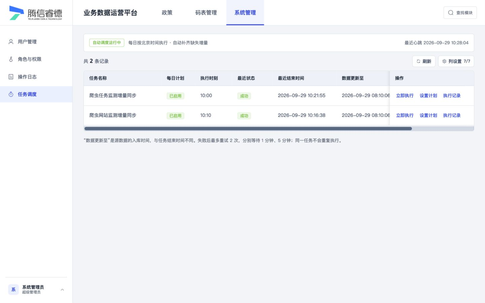
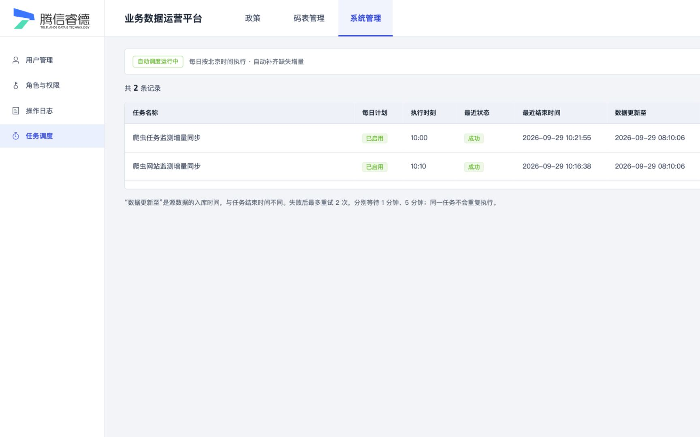

# 任务调度验收 · 2026-09-29

入口：系统管理 → 任务调度，`http://localhost:8080/system/scheduler`。

## 交付

- 独立 policy-worker；北京时间每日 10:00 / 10:10 两套增量计划。
- 页面设置、启停、手动执行、执行记录、重试原因和源数据水位。
- 同任务防重复，持久化队列，停机后一次补齐，失败最多尝试 3 次；无初始水位时拒绝自动回填。
- IAM 菜单/角色权限、接口鉴权、Outbox 审计，配置版本冲突保护。
- 新增表迁移、OpenAPI、操作文档和 UI 规范同步。

## 自动验证

- `make check` 通过：所有服务 ruff/mypy、前端类型检查/构建/lint、范围与密钥扫描。
- policy-service：107 passed；8 项隔离数据库用例在常规测试中跳过，另行显式执行 **8 passed**。
- iam-service：53 passed（已有 Starlette/AnyIO 弃用警告）。
- frontend：12 个测试文件、66 passed。
- 独立临时 PostgreSQL `scheduler_test` 空库，使用新构建的政策镜像从第一条迁移到 `c3d4e5f6a512` 成功；`alembic check` 无漂移。
- 集成覆盖并发手动请求、定时/手动竞争、错过多天合并、停用取消、版本冲突、失败重试到成功、重启恢复已成功批次、全局锁、无水位拒绝、401/403/404/409/422 与 202 入队。
- 首轮集成发现时间对象序列化错误，已修复并重跑通过。

## 真实数据验证

首次真实运行发现 worker 仅连接 internal data 网络导致外部 MySQL 不可达，补接出站网络后按既定重试自动完成；未删失败历史。

| 任务 | 结果 | 尝试次数 | 处理日期 | 结果计数 | 完成时间（北京） |
| --- | --- | --- | --- | --- | --- |
| 爬虫任务监测 | 成功 | 3 | 9 月 28–29 日 | 任务 20,312，日统计 2,009，健康快照 27,955 | 10:21:55 |
| 爬虫网站监测 | 成功 | 2 | 9 月 28–29 日 | 2 个采集日，网站快照 5,873 | 10:16:38 |

两套成功水位均为 **2026-09-29 08:10:06 北京时间**；仅增量，无全量回填。
两条手动触发和一条保存计划审计均 delivered。
重启 policy-worker 后执行记录仍为两条，无重复执行，心跳恢复健康。
下一次计划：2026-09-30 10:00 / 10:10，均已启用。

## 页面验证

- 8080 最初仍为旧镜像，提前打开新路由导致 404；已发布新前后端和目录后，登录态刷新可正常到达新路由。
- 浏览器验证真实手动入队、等待重试、成功状态、执行记录展开、日期范围/数量、水位展示。
- 修改执行时间后取消出现未保存确认，放弃测试草稿后仍为 10:10；保存原计划成功。
- 1024 / 1280 / 1440 / 1920 CSS 像素宽度均无整页横向溢出；窄窗口表格在 ScrollPort 内滚动，全列默认 7/7。
- 新前端入口哈希 `index-DO2lMnLQ.js` 与本机构建一致。
- 浏览器桌面截图接口存在像素缩放，文件按验收 CSS 宽度命名；布局宽度同时由 DOM 测量核对。

## 边界

当前只登记两套爬虫增量任务，不提供任意命令、自定义全量回填或外部消息通知。
失败提示、重试和记录已提供；电脑停机时无法执行，恢复 Docker 后补跑。记录没有自动保留期清理。
测试没有替换或清空业务库；隔离测试容器在验收后清理。
